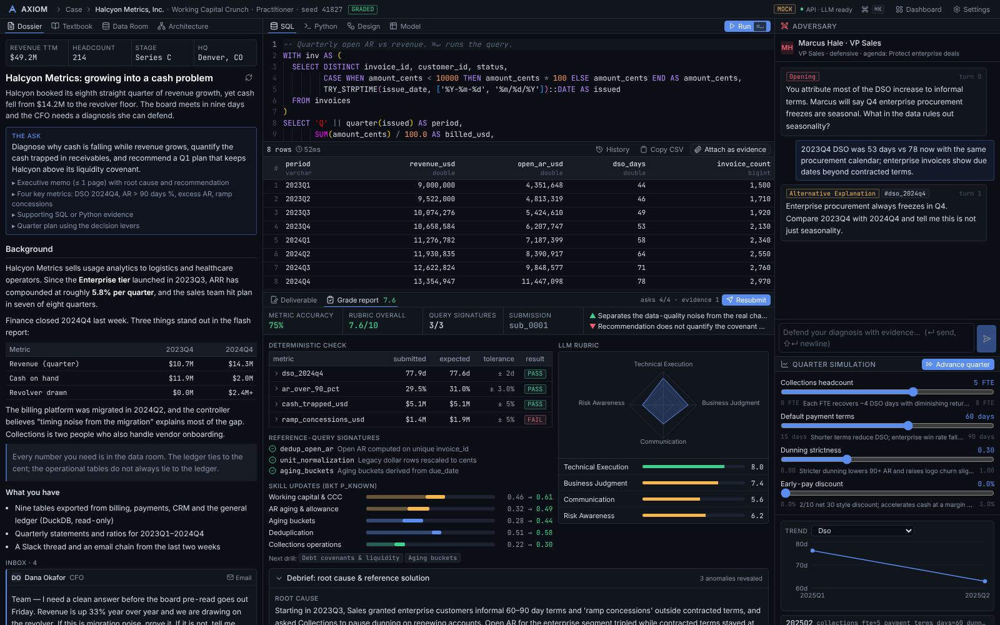

# Axiom — Procedural Generative Textbooks

Axiom is a local-first case simulator that replaces static textbooks across five pillars:
Accounting & Finance, Operations & Strategy, System Design, SQL, and Python. Every case is a
procedurally generated company with a balanced double-entry ledger, three financial statements,
an operations model, and a dirty relational database of up to 50,000 rows, with a real anomaly
injected and a ground-truth key the grader checks you against. An LLM of your choosing writes the
case dossier, teaches the theory, grades your work, and argues with you as a sceptical CFO,
VP of Engineering or board member. It never generates the numbers.



## Why it is built this way

AI tutors fail when the model invents the data: ledgers that do not balance, cohort tables that
contradict the income statement, "anomalies" that are not in the data. Axiom separates three tiers:

| Tier | What it does | What it never does |
|---|---|---|
| **Research** (`backend/axiom/engine/market_research.py`, `benchmarks/*.json`) | 261 source-cited benchmark distributions across six industries (SaaS, e-commerce, manufacturing, 3PL, retail, fintech marketplace), 19 forensic accounting patterns, six real-world schema templates, 10-K line-item bands. Works offline; optional keyless refresh from SEC EDGAR XBRL frames. | Write narrative or call a model. |
| **Deterministic engine** (`procedural_world.py`, `finance.py`, `operations.py`, `datagen.py`, `archetypes/`) | From `(archetype, seed, difficulty)` builds the company: chart of accounts, journal, trial balance, IS/BS/CFS with `Assets = Liabilities + Equity` to the cent, queueing and cohort models, DuckDB tables with deterministic dirt, and the ground-truth key. Same seed, byte-identical world. | Use unseeded randomness, or ship a world that fails an invariant. |
| **LLM pedagogy** (`llm_client.py`, `pedagogy.py`, `skill_graph.py`) | Dossier synthesis with a leak check, textbook chapters tied to the live case, rubric grading gated by the deterministic check, Socratic adversary with an escalation ladder, quarter-by-quarter simulation narration, Bayesian Knowledge Tracing over a 65-node skill DAG. | Decide whether a number is right. The deterministic grader does that first. |

The full contract between modules is in [`docs/ARCHITECTURE.md`](docs/ARCHITECTURE.md). The research
behind the numbers, the archetypes, and the pedagogy is in [`docs/research/`](docs/research/).

## Archetypes

| Pillar | Archetypes |
|---|---|
| Accounting & Finance | `working_capital_crunch`, `abc_cost_distortion`, `ma_synergies`, `forensic_revenue` |
| Operations & Strategy | `toc_bottleneck`, `cohort_collapse`, `bullwhip`, `pricing_elasticity` |
| System Design | `idempotent_webhooks`, `outbox_pattern`, `replica_lag` |
| SQL & Python | `window_reconciliation`, `cohort_matrix`, `monte_carlo_cash` |

Each archetype has infinite seeded variants and three difficulties (foundation, practitioner,
principal) that change anomaly magnitude, the number of simultaneous anomalies, data dirt,
red herrings, and rubric strictness. Every case blends at least one business pillar with one
technical pillar through the skill DAG.

## Quickstart

Requirements: Python 3.12+ and Node 22.

```bash
cd procedural-generative-textbooks/backend
./run.sh
```

```bash
cd procedural-generative-textbooks/frontend
npm install
npm run dev
```

Open http://localhost:5173, then open **Settings** (⌘K → Settings) and enter an API base URL, key
and two model names: a fast model for dossiers and chapters, a deep model for grading and the
adversary. OpenRouter, OpenAI, Anthropic and local OpenAI-compatible endpoints (Ollama, LM Studio)
are supported. The key is stored only in the local SQLite database and is masked in every response.

Case generation, the SQL sandbox and the Python sandbox work without any LLM configured.

To serve everything from one process, build the frontend and let the backend host it:

```bash
cd procedural-generative-textbooks/frontend && npm run build
cd ../backend && ./run.sh
```

Then open http://127.0.0.1:8000.

## Using the workbench

1. **Dashboard.** The skill graph shows mastery per node (Bayesian Knowledge Tracing). Click
   **Generate Procedural Case** to let Axiom pick the archetype that targets your weakest eligible
   nodes, or choose an archetype, difficulty and seed yourself.
2. **Briefing pane.** Read the dossier (stakeholder emails and Slack threads written from the
   deterministic seed, with the root cause concealed), open the textbook chapter for any skill node
   the case exercises, browse the data room (schema, dirt badges, sample rows, ERD), and for system
   design cases, the architecture diagram.
3. **Sandbox pane.** Query the case database in SQL (DuckDB, read-only, ⌘Enter to run), model it in
   Python (pandas, numpy, scipy, matplotlib; tables are preloaded as `tables["invoices"]`, the
   connection as `con`, assign to `result` to return structured output), draw the fixed architecture
   in Mermaid, or build a financial model table. Attach any output as evidence.
4. **Deliverable pane.** Fill in the case's asks (the key metrics), write the executive memo, and
   submit. The deterministic grader checks every ask against ground truth with tolerances and
   matches your SQL against reference query signatures. The LLM rubric then grades technical
   execution (capped by the deterministic result), business judgment, communication and risk
   awareness, with evidence quotes. The debrief reveals the root cause and the reference solution.
5. **Adversary pane.** Defend your diagnosis. The adversary escalates from clarification to
   counter-evidence to second-order consequences, pushing the case's red herrings. Then pull the
   decision levers and advance the company a quarter to see what your plan actually does.

## Command-line

```bash
cd procedural-generative-textbooks/backend
python -m axiom.engine.procedural_world generate --archetype forensic_revenue --seed 42 --difficulty principal
python -m axiom.engine.procedural_world inspect <case_id>        # statements, ratios, anomaly key
python -m axiom.engine.procedural_world verify --archetype bullwhip --seed 7   # determinism + invariants
python -m axiom.engine.market_research report                     # benchmark coverage and citations
```

## Tests

```bash
cd procedural-generative-textbooks/backend && python -m pytest -q          # ~7 min, 760+ tests
cd procedural-generative-textbooks/backend && python -m pytest -q -m slow  # seed sweep: 14 archetypes x 30 seeds
cd procedural-generative-textbooks/frontend && npm run build && npm run lint
```

The backend suite covers ledger invariants across seeds, every archetype at every difficulty
and seed (invariants, ground truth, reference SQL execution, Mermaid syntax, public-view leak
scan, simulation contract), determinism (byte-identical regeneration), the sandboxes
(allowlist, timeouts, memory, network, process spawning), the LLM client for both wire formats
with a fake transport, BKT updates against hand-computed values, and the API end to end with a
fake LLM. Nothing in the tests touches the network. `AXIOM_TEST_ARCHETYPES=a,b` restricts the
archetype suites while iterating.

## Quality record

- [`docs/research/review.md`](docs/research/review.md): the principal review of 28 generated
  worlds (scorecard, P0/P1/P2 punch list, cross-cutting engine issues, prompt edits). Every P0
  and P1 item has since been fixed; the remaining P2 items are listed there.
- [`docs/QA_REPORT.md`](docs/QA_REPORT.md): live verification of all 42 archetype x difficulty
  combinations through the real API and browser, with screenshots.

## Layout

```
procedural-generative-textbooks/
  docs/ARCHITECTURE.md        the binding contract between modules
  docs/research/              benchmarks, archetype designs, forensic patterns, pedagogy, review
  docs/QA_REPORT.md           live QA across all archetypes and difficulties
  backend/                    FastAPI + DuckDB/SQLite; engine, pedagogy, sandboxes, API, tests
  frontend/                   React + Vite + Tailwind + Monaco + Mermaid workbench (mock mode included)
```

See [`backend/README_BACKEND.md`](backend/README_BACKEND.md) and
[`frontend/README_FRONTEND.md`](frontend/README_FRONTEND.md) for configuration, environment
variables, the endpoint table, and mock mode.
