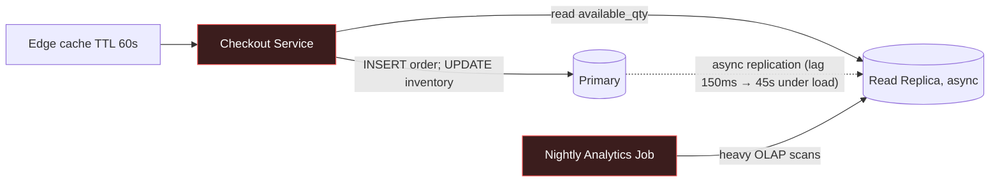

# Axiom Archetype Design Specification

Companion to `docs/research/archetype_common.md` (shared chart of accounts, journal families,
statement mapping, ops primitives, dirt and difficulty rules). This file specifies the 14
procedural archetypes that ship in `engine/archetypes/`. Each section is written so that an
engineer can implement `Archetype.params()`, `Archetype.build()` and `Archetype.ground_truth()`
without further research.

Notation: `U(a,b)` uniform; `LN(μ,σ)` lognormal; `draw(key)` = sample from the benchmark
distribution `key` using the archetype's `rng.spawn("params")` stream; `D[p]` = difficulty
multiplier where foundation → upper quartile of a magnitude range, practitioner → median,
principal → lower quartile (see common §9). All money in cents. `P1..P8` = the 8 quarters,
`M1..M24` = months. "Last k periods" = `P(9−k)..P8`.

Skill-node ids use the form `pillar.topic` and are reconciled by the pedagogy author.

---

## 1. `working_capital_crunch` — Profitable and Running Out of Cash

### Identity
- **key** `working_capital_crunch` · **title** "Profitable and Broke" 
- **primary pillar** accounting_finance · **secondary** operations_strategy, sql
- **skill nodes** `accounting_finance.working_capital`, `accounting_finance.cash_conversion_cycle`, `accounting_finance.accrual_vs_cash`, `accounting_finance.cash_flow_statement`, `accounting_finance.covenant_compliance`, `sql.aggregation_grouping`, `sql.date_bucketing`, `operations_strategy.inventory_policy`
- **difficulty** foundation → principal
- **industries** ecommerce, manufacturing, retail, 3pl · **schema** `ecommerce_oms` (default) or `manufacturing_mes`

### Real-world grounding
1. Kmart's 2002 Chapter 11: positive operating margins the prior year while suppliers were being stretched, inventory bloated ahead of holiday and a revolver was maxed — the classic "profit ≠ cash" collapse. (SEC filing history; see Kmart Form 10-K FY2001.)
2. Peloton FY2022: inventory ballooned from $937M to $1.1B+ while revenue fell; DIO exploded and the company drew a $750M term loan. https://investor.onepeloton.com/
3. Boeing 2024 supplier-advance dynamics and "stretching" payables as cash management are documented in the Hackett Group Working Capital Scorecard, which also gives the DSO/DIO/DPO industry distributions this archetype draws from. https://www.thehackettgroup.com/
4. Theory: Richards & Laughlin (1980) "A Cash Conversion Cycle Approach to Liquidity Analysis", *Financial Management* 9(1).

### Parameters
| Param | Draw | Benchmark bound |
|---|---|---|
| `revenue_ttm` | log-U(industry revenue_range) | `industries.json` |
| `growth_qoq` | U(0.06, 0.14) (fast-growing — growth is the trap) | `<ind>.revenue_growth_yoy` p75–p90 |
| `gm` | draw | `<ind>.gross_margin` |
| `dso_base, dio_base, dpo_base` | draw | `<ind>.dso/.dio/.dpo` p25–p50 |
| `dso_drift` | D[p]·U(8, 25) days over last 3 periods | — |
| `dio_drift` | D[p]·U(15, 40) days over last 3 periods | — |
| `dpo_drift` | D[p]·U(10, 30) days over last 2 periods (stretching suppliers) | — |
| `revolver_limit` | U(0.10, 0.18)·revenue_ttm | — |
| `covenant_min_current_ratio` | 1.20 · **or** `covenant_max_debt_ebitda` 3.0× | — |
| `terms_days_base` | 30 or 45 (seeded choice) | — |
| `late_pay_customer_share` | U(0.25, 0.40) of customers with `terms_days` > base in last 3 periods | — |

Correlations: `dio_drift` is driven by purchasing at `growth_forecast = growth_qoq + U(0.04, 0.08)` (over-forecast), so purchase volume = demand × (1 + over_forecast) compounding. DPO drift only begins once cash < 1.5× monthly opex (the company starts stretching when it feels the pinch), which creates a visible sequencing in the data.

### Healthy baseline construction
1. Opening BS per common §3 using base days.
2. Monthly demand: `units_m = base_units·(1+growth_qoq)^(m/3)·season_m·LN(0, 0.05)` where `season_m` is the industry seasonality vector (ecommerce: Q4 +35%).
3. For each order: 1–5 `order_items`; price from SKU price list (`products` table, 60–400 SKUs, Pareto demand α=1.16); unit cost = price·(1−gm_sku) with gm_sku ~ N(gm, 0.06).
4. Credit sales (`sale_credit`) with `terms_days_base`; payments arrive at `terms_days_base + max(0, N(5, 12))` days (`collection`).
5. Purchasing: monthly PO quantity per SKU = forecast demand next month × (1 + target cover) − on hand; received after `lead_time ~ draw(3pl.lead_time_ltl_days)`; `purchase_inventory`, paid at `dpo_base` (`vendor_payment`).
6. COGS relief per shipment; freight 3–6% of order value; payroll & opex scaled to `sga_pct_revenue`.
7. Revolver: drawn when cash < 1 month opex, repaid when cash > 2 months opex, interest 9–12%.
8. Row targets: `orders` 8–20k, `order_items` 20–50k capped by scale, `products` 60–400, `customers` 1–3k, `payments` ≈ orders, `purchase_orders` 300–1200, `inventory_movements` ≈ order_items + PO lines, `shipments` ≈ orders, `suppliers` 20–60, `gl_journal`/`gl_lines` mirror.

### Anomaly injection
- **A1 Receivables stretch (P6–P8)**: `late_pay_customer_share` of customers (biased to the largest 20% by revenue — they have bargaining power) get `terms_days = base + dso_drift` on new invoices; actual payment lag adds `N(10,8)` more. Journal effect: no change to `sale_credit`; `collection` entries shift later. AR gross rises; DSO rises by ≈ `dso_drift·share·(revenue share of those customers)/… ` — compute realized DSO from the data, do not hard-code.
- **A2 Inventory build (P6–P8)**: purchasing uses over-forecast; POs ≈ demand·(1+over_forecast)^k. Inventory (1220) rises; DIO rises; no write-down taken (the decoy: management believes it will sell through). `inventory_movements` show receipts outpacing issues.
- **A3 Payables stretch (P7–P8)**: once cash < 1.5× monthly opex, vendor payment lag = `dpo_base + dpo_drift`; 15% of suppliers respond by shortening terms (`suppliers.terms_days` down) or putting the account on credit hold (`purchase_orders.status='on_hold'`), causing stockouts on 5–10% of fast-moving SKUs in P8 (`order_items.backordered=1`).
- **A4 Revolver at limit (P8)**: draws hit `revolver_limit`; covenant breach computed: current ratio falls below 1.20 or debt/EBITDA exceeds 3.0×.
- Consistency: all four are ordinary journal families with shifted timing/quantities — **every §7 invariant holds** and **every sub-ledger tie holds**. The lesson is that nothing is "wrong" in the books; the cash is in AR and inventory.
- Difficulty: principal adds a decoy — a one-off `capex` of 4% revenue in P7 (new warehouse racking) so a lazy answer blames capex.

### Red herrings
1. "Gross margin is compressing" — GM does dip ~1.5pt in P7–P8 from freight surcharges (`shipments.freight_cost` +20%), but that explains <10% of the cash gap.
2. "The capex spend did it" (principal only) — true cash out, but CFI ≪ ΔWC.
3. "Sales slowed" — revenue is still growing every quarter; the problem is growth-funded working capital.

### Ground-truth key
| ExpectedMetric key | Derivation | tol |
|---|---|---|
| `ccc_p8_days` | `dso + dio − dpo` for P8 from statements.ratios | abs 3 |
| `ccc_delta_p5_to_p8_days` | `ccc_P8 − ccc_P5` | abs 4 |
| `delta_wc_cash_drag_p6_p8_cents` | `Σ_{P6..P8} (ΔAR_gross + ΔInventory − ΔAP)` | rel 0.05 |
| `cfo_minus_ni_p6_p8_cents` | `Σ(CFO − NI)` P6..P8 | rel 0.05 |
| `late_terms_customer_revenue_share` | revenue P6–P8 from customers with terms > base ÷ total revenue | abs 0.04 |
| `excess_inventory_cents` | `inventory_P8 − (cogs_P8/days)·dio_base` | rel 0.10 |
| `revolver_utilization_p8` | `drawn / limit` | abs 0.03 |
| `covenant_breached` | 1/0 | exact |
| `cash_runway_months` | `cash_P8 / avg monthly (opex + interest − CFO_ex_WC)`; if ≥ 0 | abs 1 |

Reference SQL (DuckDB):
```sql
-- DSO by quarter from the sub-ledger, not the statements
WITH inv AS (
  SELECT date_trunc('quarter', invoice_date) q, SUM(amount_cents) rev FROM invoices GROUP BY 1),
ar AS (
  SELECT q, SUM(open_cents) ar FROM (
    SELECT date_trunc('quarter', i.invoice_date) q,
           i.amount_cents - COALESCE(SUM(p.amount_cents),0) open_cents
    FROM invoices i LEFT JOIN payments p ON p.invoice_id = i.invoice_id
      AND p.paid_at <= last_day_of_quarter(i.invoice_date)
    GROUP BY 1, i.invoice_id, i.amount_cents) GROUP BY 1)
SELECT inv.q, 91.25 * ar.ar / inv.rev AS dso_days FROM inv JOIN ar USING (q) ORDER BY 1;
```
Expected signature: `dso_days` monotone increasing from P6; P8 − P5 ≥ 0.6·dso_drift.
```sql
-- Terms creep concentrated in large customers
SELECT c.segment, AVG(i.terms_days) avg_terms, SUM(i.amount_cents) rev
FROM invoices i JOIN customers c USING (customer_id)
WHERE i.invoice_date >= '<P6 start>' GROUP BY 1 ORDER BY rev DESC;
```
Python reference: pandas roll-forward computing `ΔWC` by quarter and a 12-month cash forecast under three scenarios (collect at base terms / liquidate excess inventory at 70¢ / both).

### Evidence trail
1. IS shows net income positive and growing; CFS shows CFO negative P7–P8 → accrual gap.
2. Ratios: DSO +X, DIO +Y, DPO +Z → CCC lengthened.
3. `invoices.terms_days` distribution shifted; concentrated in top customers.
4. `inventory_movements`: receipts/issues ratio > 1.3 for 3 quarters; sell-through by SKU shows slow movers.
5. `suppliers.terms_days` tightened and `purchase_orders.status='on_hold'` → supplier response → backorders.
6. Revolver at limit; covenant test fails → the actual near-term risk.

### Dossier seed
- **reveal**: revenue growth streak; "record quarter" board language; CFO's note that the revolver is "temporarily fully drawn"; a supplier email about late payments; the new racking capex (principal).
- **conceal**: the words "cash conversion cycle", terms creep for large customers, the over-forecast purchasing rule, covenant status, excess inventory value.
- **stakeholders**: CEO (agenda: keep growth narrative, knows revolver is maxed, hides that they approved extended terms for the top accounts); CFO (agenda: refinance, knows covenant test is next month, hides that inventory has no write-down); VP Sales (agenda: hit quota, knows they gave 90-day terms, frames it as "enterprise standard"); Head of Supply Chain (agenda: avoid stockouts, knows the forecast was aggressive, hides the on-hold suppliers).
- **timeline**: P5 "Series B-style growth plan approved"; P6 "Top-3 customer renews at larger volume" (terms change not mentioned); P6 "Warehouse expansion" (decoy, principal); P7 "Freight surcharges hit" (**red herring**); P7 "Revolver drawn to fund inventory for peak season"; P8 "Two suppliers move to prepayment"; P8 "Record revenue quarter".
- **artifacts**: board deck excerpt (revenue + EBITDA only), bank covenant letter excerpt (redacted ratio), supplier email, AR aging export reference.

### Decision levers & quarter simulation
| Lever | Range | Unit | Effect |
|---|---|---|---|
| `credit_terms_days` | 15–90 | days | DSO_next = f(terms); revenue growth adjusts by `ε_terms = −0.004 per day` tightened below base (lost sales) |
| `early_pay_discount_pct` | 0–3 | % | share of AR collected early `= 0.25·discount_pct`; cost = discount × collected |
| `inventory_liquidation_pct` | 0–60 | % of excess | cash in at 0.65–0.80 recovery; `inventory_writedown` for the haircut; DIO falls |
| `purchase_cover_months` | 0.5–3 | months | future DIO; stockout rate rises below 1.0 (`stockout = max(0, (1.0−cover))·0.15`) |
| `vendor_terms_days` | 30–75 | days | DPO; above 50 supplier-hold probability rises 2%/day → backorders |
| `revolver_draw_cents` | 0–limit | cents | cash; interest |
| `equity_raise_cents` | 0–0.2·revenue | cents | cash; dilution noted |
Transition: next-quarter revenue `R' = R·(1+growth)·(1 + ε_terms·Δterms)·(1 − stockout)`; AR' = R'·DSO'/days; inventory' from cover; AP' from vendor terms; cash' = cash + CFO' + CFI' + CFF'; covenant retested. Second-order: vendor terms > 60 for two quarters raises unit cost 3% (suppliers reprice risk).

### Socratic traps
1. "Net income is up 20% — why is the bank worried?" → Accrual profit ≠ cash; CFO is negative because ΔWC absorbed it; show CFO−NI bridge.
2. "Isn't the inventory an asset? It is worth what we paid." → Only if it sells at cost in time; sell-through data shows slow movers; carrying cost + obsolescence; the covenant is on current ratio, not on belief.
3. "We should stop extending credit to everyone." → Terms creep is concentrated in the top-quintile customers; a blanket policy loses good customers; target the concentration.
4. "The freight surcharge is the real story." → Quantify: GM drag is ~1.5pt ≈ small fraction of the cash gap vs ΔWC.
5. "Just stretch vendors further." → Already triggered holds and backorders; second-order cost exceeds financing cost of a revolver increase.
6. "Raise equity and move on." → Possible, but valuation hit and the operating cause (forecast rule) persists; fix the CCC first.

---

## 2. `abc_cost_distortion` — The Profitable Product That Isn't

### Identity
- **key** `abc_cost_distortion` · **title** "Peanut-Butter Overhead"
- **primary** accounting_finance · **secondary** operations_strategy, python
- **skill nodes** `accounting_finance.cost_allocation`, `accounting_finance.activity_based_costing`, `accounting_finance.contribution_margin`, `accounting_finance.variance_analysis`, `operations_strategy.product_mix`, `python.pandas_wrangling`, `sql.joins`
- **difficulty** foundation → principal
- **industries** manufacturing, 3pl, ecommerce · **schema** `manufacturing_mes` (default) / `logistics_tms`

### Real-world grounding
1. Cooper & Kaplan, "Measure Costs Right: Make the Right Decisions", *HBR* Sept–Oct 1988 — the canonical demonstration that volume-based allocation overcosts high-volume simple products and undercosts low-volume complex ones. https://hbr.org/1988/09/measure-costs-right-make-the-right-decisions
2. Kaplan & Anderson, "Time-Driven Activity-Based Costing", *HBR* Nov 2004 — capacity-cost-rate × time-per-activity, which is the formula used here. https://hbr.org/2004/11/time-driven-activity-based-costing
3. The Wilkerson Company (HBS 9-101-092) and Destin Brass (HBS 9-190-089) cases — the three-product structure and the "valves/pumps/flow controllers" result pattern are reproduced in the parameter correlations.
4. Hilton Manufacturing and other ToC-vs-ABC literature (Goldratt, *The Haystack Syndrome*) for why the "unprofitable" product may still be worth keeping (throughput accounting) — used as the principal-difficulty twist.

### Parameters
| Param | Draw | Bound |
|---|---|---|
| `n_products` | 3 families × 12–40 SKUs | — |
| `volume_share` | Dirichlet(8, 3, 1) across families (high / mid / low volume) | — |
| `complexity_share` of setups, engineering changes, special handling | Dirichlet(1, 3, 8) (inverse of volume) | — |
| `overhead_pct_of_conversion` | U(0.45, 0.65) | `manufacturing.overhead_pct_conversion` |
| `allocation_base` | "direct_labor_hours" (seeded alt: machine hours) | — |
| `setup_time_min` per family | (20, 45, 110) × U(0.8, 1.2) | `manufacturing.setup_time_minutes` |
| `price_markup_on_reported_cost` | U(0.25, 0.40) | — |
| `distortion_target` | D[p]·U(0.15, 0.35) = relative error in low-volume unit cost | — |
| `practical_capacity_pct` | U(0.80, 0.90) (TDABC uses practical, not theoretical, capacity) | `manufacturing.oee` |

Correlations: pricing is set as reported (volume-allocated) cost × markup → the low-volume complex family is underpriced and *appears* to be the highest-margin line; sales mix drifts toward it over P1–P8 (`+2pt share per quarter`), so reported GM holds while true margin erodes — this is the detectable signature.

### Healthy baseline construction
1. `work_centers` (6–10): cutting, machining, assembly, finishing, inspection, packaging, with `capacity_hours_month`.
2. `routings`: family-specific operation sequences with `run_min_per_unit` and `setup_min`.
3. `bom`: RM per SKU; `products.standard_cost` = RM + direct labor (`run_min/60 × labor_rate`) + overhead (`direct_labor_hours × plantwide_rate`), `plantwide_rate = total_overhead / total_DLH`.
4. `work_orders` monthly per SKU with `qty` from demand mix; `production_log` rows per operation (start/end timestamps, setup flag, scrap qty ~ draw(`manufacturing.scrap_rate`)).
5. Overhead pools: setups (`setup_cost = setup_min × crew_rate`), material handling (per receipt/move), engineering changes (`quality_events`/`eco` rows per family), inspection, utilities/depreciation (truly volume-driven). Pool totals Σ = `overhead_pct_of_conversion × conversion cost`.
6. GL: RM purchases → 1200; WIP absorption → 1210 (Dr) from 1200/2110/5020-absorbed; FG → 1220; COGS at **standard** cost on shipment; over/under-absorbed overhead closed to 5020 quarterly. `sale_credit` at family price.
7. Row targets: `work_orders` 1.5–4k, `production_log` 10–30k, `bom` 300–1500, `quality_events` 200–800, `inventory` movements 5–15k.

### Anomaly injection
- This archetype has no fraud; the "anomaly" is a **measurement error** that the data can correct. The GL is internally consistent at standard cost. The distortion is baked into `products.standard_cost` and therefore into reported family margins and pricing.
- The generator computes a hidden **ABC/TDABC cost** per SKU: `abc_cost = RM + DL + Σ_pools (driver_qty_sku × pool_rate)` with `pool_rate = pool_cost / practical_capacity_driver_qty`. The engine chooses pool sizes so that `(volume_cost − abc_cost)/abc_cost` for the low-volume family ≈ `−distortion_target` and for the high-volume family ≈ `+distortion_target × volume_share_high/volume_share_low × …` (set by solving for pool costs — implement as: fix driver quantities from the production data, choose setup-pool and ECO-pool costs so the low-volume family's distortion hits target, assign the remainder to the volume pool).
- Mix drift: the sales mix share of the low-volume family rises by `+2pt/quarter` because reps are paid on reported margin (`commission_plan.basis='reported_margin'` in a `sales_reps` table). Reported GM stays flat ±0.5pt; **true GM falls** ≈ `distortion_target × Δshare × …` and total operating income falls despite "selling more of the best product". Overhead actuals rise (`production_log` setup minutes +, `quality_events` +), appearing in the GL as a growing **under-absorbed overhead variance** closed to 5020 each quarter — the visible accounting trace.
- Invariants: all hold. Ties: all hold. The sub-ledger "tie" that breaks is conceptual: `Σ standard COGS ≠ actual conversion cost`, shown by the variance account.

### Red herrings
1. "Scrap rate is rising" — it rises slightly in the complex family, a symptom not the cause.
2. "Labor rates went up" — payroll per hour is flat; DLH per unit flat.
3. "Discounting on the high-volume family" — some discount creep exists (+1pt) but the family is still truly most profitable.

### Ground-truth key
| key | Derivation | tol |
|---|---|---|
| `plantwide_rate_per_dlh_cents` | Σ overhead / Σ DLH over P1–P8 | rel 0.03 |
| `abc_unit_cost_family_low_cents` | TDABC formula above | rel 0.05 |
| `abc_unit_cost_family_high_cents` | ″ | rel 0.05 |
| `distortion_low_family_pct` | (std − abc)/abc | abs 0.04 |
| `true_margin_family_low_pct` | (price − abc)/price | abs 0.03 |
| `reported_margin_family_low_pct` | (price − std)/price | abs 0.02 |
| `underabsorbed_overhead_p8_cents` | 5020 variance closing P8 | rel 0.05 |
| `mix_shift_low_family_pts` | share_P8 − share_P1 | abs 0.02 |
| `operating_income_at_p1_mix_cents` | counterfactual OI P8 at P1 mix (true costs) | rel 0.08 |

Reference SQL:
```sql
-- Setup minutes per unit by family (the driver the plantwide rate ignores)
SELECT p.family,
       SUM(CASE WHEN l.is_setup THEN l.minutes END) / SUM(w.qty_good) AS setup_min_per_unit,
       SUM(CASE WHEN NOT l.is_setup THEN l.minutes END) / SUM(w.qty_good) AS run_min_per_unit
FROM production_log l JOIN work_orders w USING (work_order_id) JOIN products p USING (sku)
GROUP BY 1 ORDER BY setup_min_per_unit DESC;
```
Signature: low-volume family setup_min_per_unit ≥ 4× high-volume family.
Python reference: build pool rates from `production_log`, `quality_events`, `inventory_movements`; compute ABC cost per SKU; margin waterfall by family; counterfactual mix.

### Evidence trail
1. Family P&L shows the low-volume family as highest-margin, and its mix share rising.
2. Operating income down while reported GM flat → look at 5020 variance.
3. Under-absorbed overhead growing every quarter.
4. Driver analysis: setups, ECOs, inspections concentrated in the low-volume family.
5. Recompute costs with activity drivers → distortion; reprice/mix decision.
6. (principal) Check the bottleneck: if the low-volume family has the best throughput per bottleneck-minute, keep it but reprice (ToC twist).

### Dossier seed
- reveal: family P&L (standard cost basis), mix shift, "our premium line is our best product" CEO quote, the variance line labelled "manufacturing variances" without explanation, commission plan basis.
- conceal: the allocation base, the words "activity-based", pool driver quantities, the hidden ABC cost table, the counterfactual.
- stakeholders: COO (agenda: capacity expansion for the premium line; knows setups are eating the plant; hides it to protect the plan), Controller (agenda: a clean close; knows variances are "unusual"; hides that the standard was last reset 3 years ago), VP Sales (agenda: commission plan; hides that the premium line is easy to sell because it is cheap), Plant Manager (knows the real time per unit; nobody has asked).
- timeline: P2 "Commission plan moved to margin basis"; P3 "Premium line marketing push"; P5 "Scrap initiative" (**red herring**); P6 "Capex request for second finishing line"; P7 "Variance line flagged by auditors"; P8 "OI miss despite record premium sales".
- artifacts: family P&L, commission plan memo, plant capacity chart, auditor management letter excerpt.

### Decision levers & quarter simulation
| Lever | Range | Unit | Effect |
|---|---|---|---|
| `price_change_family_low_pct` | −10 to +40 | % | volume via ε = draw(`operations.elasticity_industrial`) ≈ −1.2; true margin |
| `price_change_family_high_pct` | −15 to +10 | % | ε ≈ −1.8 |
| `discontinue_family_low` | 0/1 | — | removes revenue and *avoidable* activity costs only (`avoidable_share = 0.6` of pool costs in year 1); fixed overhead remains → OI may fall (trap) |
| `setup_reduction_pct` (SMED program) | 0–50 | % | setup minutes; costs `U(1,2)%` revenue one-off |
| `commission_basis` | reported / abc | — | mix drifts back 1pt/quarter under abc |
| `min_batch_size_low` | 1–5× | × | setups per unit ÷ factor; inventory + DIO up |
Transition: recompute pool usage from mix and setups; `OI' = Σ_family (price·qty − abc_cost·qty) − unavoidable fixed`.

### Socratic traps
1. "The premium line has 48% margin — why cut its price?" → That margin uses a labor-hour allocation; activity drivers show it consumes 5× setups per unit; true margin is single digits.
2. "Then kill it." → Discontinuing removes revenue but only ~60% of its overhead is avoidable short-run; show the counterfactual OI falls; reprice first.
3. "ABC is too complex for a plant our size." → TDABC needs two numbers per activity: capacity cost rate and time; the data already exists in `production_log`.
4. "Scrap is the issue." → Scrap delta explains < 1pt; setup/ECO drivers explain the rest.
5. "Reps sold what we told them to." → The commission plan basis created the mix drift; fix the incentive, not the people.
6. (principal) "If setups are the problem, is the bottleneck the issue, not the cost?" → Compute throughput per bottleneck minute per family; the answer may be "keep and reprice" not "drop".

---

## 3. `ma_synergies` — Buying a Company with Someone Else's Spreadsheet

### Identity
- **key** `ma_synergies` · **title** "Synergy Math"
- **primary** accounting_finance · **secondary** operations_strategy, python
- **skill nodes** `accounting_finance.dcf_valuation`, `accounting_finance.capital_budgeting`, `accounting_finance.purchase_accounting`, `accounting_finance.sensitivity_analysis`, `operations_strategy.ma_integration`, `operations_strategy.competitive_moats`, `python.monte_carlo`, `python.pandas_wrangling`
- **difficulty** practitioner → principal
- **industries** saas, 3pl, retail, manufacturing · **schema** `saas_billing` (acquirer) + a mirrored `target_*` table set

### Real-world grounding
1. McKinsey, "Where mergers go wrong" (Christofferson, McNish, Sias, 2004): 70% of deals miss revenue synergies; cost synergies are met ~60% of the time but often later than planned. https://www.mckinsey.com/capabilities/strategy-and-corporate-finance/our-insights/where-mergers-go-wrong
2. Damodaran, "The Value of Synergy" (2005) — synergy valuation as ΔFCF discounted at the combined WACC, and the warning on paying for synergies up front. https://pages.stern.nyu.edu/~adamodar/pdfiles/papers/synergy.pdf
3. Teladoc / Livongo (2020, $18.5B; $9.6B+ goodwill impairment by 2022) — revenue-synergy overreach with customer-overlap dis-synergy. Teladoc 10-K FY2022.
4. HP / Autonomy (2011) — target revenue quality (reseller/round-trip transactions) overstated run-rate; the principal variant adds a target revenue-quality issue.

### Parameters
| Param | Draw | Bound |
|---|---|---|
| `acquirer_revenue`, `target_revenue` | target = U(0.15, 0.40) × acquirer | industries.json |
| `target_growth`, `acquirer_growth` | target growth U(0.20, 0.45) yoy; acquirer U(0.05, 0.15) | `saas.revenue_growth_yoy` |
| `wacc` | U(0.09, 0.12) | `any.wacc` |
| `terminal_growth` | U(0.02, 0.03) | — |
| `cost_synergy_claimed_pct` | U(0.12, 0.20) of target opex | — |
| `cost_synergy_achievable_pct` | claimed × U(0.55, 0.80); ramp 25/50/75/100% over 4 quarters; one-time cost to achieve = 1.0–1.5× annual run-rate | McKinsey |
| `revenue_synergy_claimed_pct` | U(0.08, 0.15) of target revenue | — |
| `revenue_synergy_achievable_pct` | claimed × U(0.20, 0.45) | McKinsey |
| `customer_overlap_pct` | U(0.10, 0.25) of target customers also acquirer customers → dis-synergy churn `U(0.15, 0.30)` of overlap ARR | — |
| `premium_pct` | U(0.25, 0.45) over standalone DCF | — |
| `deal_price` | standalone_value × (1 + premium) | — |
| `target_rev_quality_issue` (principal) | U(0.05, 0.10) of target ARR is one-time services mislabelled as recurring | — |

Correlations: the claimed synergies are tuned so that the deal looks NPV-positive at claimed and NPV-negative at achievable + dis-synergy. `premium ≈ PV(claimed synergies) × U(0.9, 1.1)` — management paid the full claimed synergy to the seller.

### Healthy baseline construction
1. Build the **acquirer** as a standard SaaS company (common §3, `saas_billing` schema, 8 quarters, `customers`, `subscriptions`, `invoices`, `invoice_lines`, `payments`, `usage_events`).
2. Build the **target** as a second, smaller SaaS company with its own `target_customers`, `target_subscriptions`, `target_invoices`, `target_invoice_lines`, `target_gl_journal`, `target_gl_lines`, `target_opex_by_dept` (8 quarters). Overlap: `customer_overlap_pct` of target customers share `email_domain` (fuzzy: case/whitespace dirt) with acquirer customers.
3. Deal close at end of **P6**. Purchase accounting entry in the acquirer GL: Dr 1710 identified intangibles (customer relationships = `U(0.25,0.35)` of price, developed tech `U(0.10,0.15)`), Dr 1700 goodwill (plug), Dr target net assets at fair value, Cr 1000 (cash portion = `U(0.5,0.7)`), Cr 2610 (acquisition debt). Amortize intangibles over 7 / 5 years from P7.
4. P7–P8 consolidated: target revenue & opex flow into the acquirer GL with `dimension.entity='target'`. Realized synergies in P7–P8 follow the achievable ramp (so the data already shows the shortfall vs the deal model).
5. A `deal_model` table (or JSON artifact) holds management's projections: synergy run-rate by quarter, claimed, integration cost.
6. Row targets: acquirer tables as SaaS baseline (invoices 5–15k); target ≈ 25% of that.

### Anomaly injection
- **A1 Synergy shortfall**: realized cost synergies in `opex_by_dept` for P7–P8 = `achievable × ramp` vs plan; the integration one-time costs hit 6200 (Dr 6200, Cr 2100) and are presented in the deck as "non-recurring".
- **A2 Overlap churn**: `overlap × dis-synergy` of target subscriptions are `status='cancelled'` in P7–P8 with `cancel_reason='consolidated vendor'`; revenue synergy cross-sell rows (`invoice_lines.product='bundle'`) appear at achievable rate only.
- **A3 (principal) target revenue quality**: `target_invoice_lines` with `line_type='services'` but `subscriptions.plan='recurring'` flag — ARR used in the deal model counted them as recurring.
- **A4 Goodwill**: goodwill = `deal_price − FV net assets`; an impairment test at P8 using achievable synergies yields `implied_fair_value < carrying` by `impairment_cents` (ASC 350 one-step); the books have **not** recorded it (the forward-looking risk).
- Invariants: all hold. Purchase accounting is itself balanced. The "break" is between the **deal model artifact** and the realized data.

### Red herrings
1. "Integration costs are one-time; strip them out and we're on plan" — they are real cash and ~1.3× run-rate; and even ex-integration the run-rate synergy is short.
2. "Target growth slowed because of macro" — overlap-churn reasons are explicit in the data.
3. "Goodwill is fine; the auditors signed P7" — impairment testing is annual/triggered; P8 trigger exists.

### Ground-truth key
| key | Derivation | tol |
|---|---|---|
| `standalone_target_dcf_cents` | 5-yr FCF at target growth decaying to terminal, WACC, Gordon terminal | rel 0.06 |
| `pv_claimed_synergies_cents` | PV of claimed cost+revenue synergies net of integration cost | rel 0.06 |
| `pv_achievable_synergies_cents` | PV at achievable incl. dis-synergy churn | rel 0.08 |
| `deal_npv_claimed_cents` | standalone + PV claimed − price | rel 0.10 |
| `deal_npv_achievable_cents` | standalone + PV achievable − price | rel 0.10 |
| `realized_cost_synergy_run_rate_p8_pct_of_plan` | (plan opex − actual opex)/plan synergy at P8 | abs 0.08 |
| `overlap_churn_arr_cents` | cancelled ARR with consolidated reason | rel 0.05 |
| `goodwill_cents` | from entry | exact |
| `goodwill_impairment_cents` | max(0, carrying − implied FV) | rel 0.15 |
| `breakeven_synergy_pct` | synergy % at which NPV=0 | abs 0.02 |
| (principal) `target_arr_overstated_pct` | services mislabelled / stated ARR | abs 0.02 |

Reference Python: DCF with sensitivity table (WACC × synergy realization), Monte Carlo on achievable % (triangular from McKinsey ranges), goodwill impairment test. Reference SQL: overlap detection via normalized domains:
```sql
SELECT COUNT(*) overlap_customers, SUM(ts.mrr_cents)*12 overlap_arr
FROM target_customers tc
JOIN customers ac ON lower(trim(split_part(ac.email,'@',2))) = lower(trim(split_part(tc.email,'@',2)))
JOIN target_subscriptions ts ON ts.customer_id = tc.customer_id AND ts.status='active';
```

### Evidence trail
1. Deal model synergy plan vs `opex_by_dept` actuals P7–P8 → shortfall.
2. Target subscription cancellations clustered post-close with the consolidation reason → dis-synergy.
3. Rebuild DCF standalone → premium paid ≈ 100% of claimed synergies.
4. NPV at achievable < 0; breakeven synergy > achievable.
5. Goodwill impairment exposure.
6. (principal) ARR quality: services mislabelled.

### Dossier seed
- reveal: deal announcement, headline synergy numbers, consolidated P7–P8 results, "integration on track" language, that intangibles are being amortized.
- conceal: achievable multipliers, overlap percentage, the impairment math, mislabelled services.
- stakeholders: CEO (agenda: deal was their thesis; hides that the premium equals full synergies), CFO (agenda: avoid impairment; knows the P8 trigger), Head of Integration (knows the ramp is slipping; hides the integration cost overrun), Target's former CEO now GM (agenda: earn-out; knows the overlap customers are leaving).
- timeline: P5 "LOI signed"; P6 "Close; $X goodwill"; P7 "Integration PMO reports 90% of milestones hit" (**red herring**: milestones ≠ dollars); P7 "Macro softness commentary" (**red herring**); P8 "Three overlap customers consolidate"; P8 "Board asks for synergy tracker".
- artifacts: deal model summary table, board announcement, integration PMO dashboard excerpt, target customer list export.

### Decision levers & quarter simulation
| Lever | Range | Effect |
|---|---|---|
| `integration_spend_cents` | 0–2× plan | accelerates cost synergy ramp: `ramp' = min(1, ramp + 0.15·spend/plan)` |
| `retention_program_pct_discount` | 0–20 | reduces overlap churn by `0.6·discount/20`, costs discount × overlap ARR |
| `price_harmonization` | none/up/down | ±ARPA, churn ε |
| `record_impairment` | 0/1 | non-cash charge; equity down; covenant check; signals credibility |
| `divest_target_unit_pct` | 0–100 | cash in at `0.7× standalone`; removes synergies |
Transition: realized synergy, churn, FCF, goodwill carrying vs implied FV recomputed each quarter.

### Socratic traps
1. "We're at 90% of integration milestones." → Milestones measure activity; the opex run-rate shows 55–80% of the dollars, later than planned.
2. "The premium was market." → PV(claimed synergies) ≈ premium; the buyer paid the seller for synergies the buyer must deliver; at achievable the NPV is negative.
3. "Revenue synergies will come next year." → Base rate: ~70% miss; dis-synergy churn is already in the data.
4. "Impairment is non-cash, so it doesn't matter." → It changes equity, covenants, and management credibility; the trigger exists now.
5. "The DCF is too sensitive to WACC to be useful." → Present the sensitivity grid; the deal is negative across the plausible grid at achievable synergies.
6. (principal) "ARR is ARR." → Services lines booked as recurring inflate the multiple paid by ~X%.

---

## 4. `forensic_revenue` — The Quarter That Was Too Good

### Identity
- **key** `forensic_revenue` · **title** "Quarter-End Magic"
- **primary** accounting_finance · **secondary** sql, python
- **skill nodes** `accounting_finance.revenue_recognition`, `accounting_finance.forensic_analysis`, `accounting_finance.accrual_vs_cash`, `accounting_finance.beneish_sloan`, `sql.window_functions`, `sql.date_bucketing`, `sql.reconciliation`, `python.statistical_tests`
- **difficulty** foundation → principal
- **industries** manufacturing, ecommerce (wholesale channel), saas (principal variant) · **schema** `ecommerce_oms` with wholesale `channel` dimension, or `saas_billing`

### Real-world grounding
1. Sunbeam (1997–98): bill-and-hold and channel stuffing; SEC AAER 1393 (2001). https://www.sec.gov/litigation/admin/33-7976.htm
2. Bristol-Myers Squibb (2000–01): ~$1.5B channel stuffing of wholesalers; SEC 2004 settlement. https://www.sec.gov/news/press/2004-105.htm
3. Luckin Coffee (2020): fabricated sales via round-tripping; SEC order Dec 2020. https://www.sec.gov/news/press-release/2020-319
4. Schilit, Perler & Engelhart, *Financial Shenanigans* (4th ed., 2018), Ch. 3–4 (recording revenue too soon; bogus revenue); Beneish (1999) M-score; Sloan (1996) accrual anomaly.

### Parameters
| Param | Draw | Bound |
|---|---|---|
| `baseline_revenue`, `growth` | moderate growth U(0.02, 0.05) qoq; management guidance implies U(0.06, 0.09) (the pressure) | `<ind>.revenue_growth_yoy` |
| `stuffing_pct` | D[p]·U(0.06, 0.18) of P7–P8 revenue pulled forward | `forensic.channel_stuffing_magnitude` |
| `mechanism` | seeded choice: `channel_stuffing` / `bill_and_hold` / `premature_cutoff` / (principal) mix of two + `round_trip` 1–2% | forensic_patterns.json |
| `stuffed_terms_days` | base + U(45, 90) | — |
| `return_rate_base` | draw | `<ind>.return_rate` |
| `stuffed_return_multiplier` | U(2.5, 4.0) in P+1 | Schilit |
| `quarter_end_window_days` | 5 (share of quarterly revenue in last 5 days: base U(0.10, 0.14) → stuffed U(0.25, 0.40)) | — |
| `distributor_count` | 8–25 wholesale accounts; stuffing concentrated in top 3–5 | — |
| `allowance_pct` | base draw; **held flat** despite AR growth (secondary signal) | `<ind>.allowance_pct_ar` |

Correlations: DSO rises ≈ `stuffing_pct × stuffed_terms_days` weighted; CFO flat while NI rises; Beneish DSRI > 1.2, GMI ≈ 1, SGI > 1.1, TATA > 0.03 in P8 TTM.

### Healthy baseline construction
1. Standard ecommerce/wholesale baseline (common §3, `ecommerce_oms`): `customers` with `channel ∈ {direct, wholesale}`; wholesale orders larger, net-45 terms; `orders`, `order_items`, `shipments` (`ship_date`, `delivered_at`), `invoices` (`invoice_date`, `terms_days`), `payments`, `returns` (`return_date`, `reason`), `products`, `inventory_movements`.
2. Revenue recognition point: shipment (`ship_date`). `sale_credit` posted on `invoice_date == ship_date`.
3. Intra-quarter revenue is uniform-ish by business day with a mild month-end bump (last 5 days ≈ 12%).
4. Returns: `return_rate_base` with 20–40 day lag; `return` family entries; refund liability at quarter end.
5. Row targets: `orders` 10–25k, `order_items` 25–50k (scale-capped), `shipments` ≈ orders, `invoices` 6–15k (wholesale consolidated), `returns` 500–2k.

### Anomaly injection (by mechanism)
- **channel_stuffing (P7, P8)**: create `stuffing_pct × quarterly revenue` of extra wholesale orders in the last `quarter_end_window_days` for the top 3–5 distributors; `invoices.terms_days = stuffed_terms_days`; `orders.discount_pct` +U(5, 12)pt ("quarter-end promotion"); shipments real (`ship_date` in window). P+1: `returns` on those orders at `stuffed_return_multiplier × base`, and the *following* quarter's normal orders from those distributors drop by `U(0.5, 0.8) × stuffed amount` (they are over-inventoried). GL: `sale_credit` normal; `return` entries in P+1; allowance held flat (`bad_debt_provision` uses stale %).
- **bill_and_hold (P8)**: orders with `invoices.invoice_date` in P8 but `shipments.ship_date` in P9 (or `ship_date NULL`, `shipments.status='awaiting_release'`); `orders.notes` contain "customer requested hold" for a subset. GL: `sale_credit` dated P8 (wrong) while `cogs_relief` dated at ship (so GM in P8 is anomalously high — second signature). Inventory still physically on hand → `inventory_movements` show no issue, so **Inventory sub-ledger ≠ GL COGS timing**.
- **premature_cutoff (P8)**: `invoice_date` in last 3 days of P8 with `ship_date` in first 5 days of P9 for `stuffing_pct` of revenue — classic cutoff error. Same GL effect as bill-and-hold but without hold notes.
- **round_trip (principal, 1–2%)**: a `vendor` in `suppliers` and a `customer` share `tax_id`/address (dirt: case/whitespace); purchases from the vendor ≈ sales to the customer in the same month; margin on those sales ≈ 0.
- Consistency: GL ties to `invoices`; the **break** is between revenue recognized (GL/invoices) and economic delivery (`shipments`) by exactly `stuffing_pct × revenue_P8` (bill-and-hold/cutoff), or between P8 revenue and P9 returns/order drop (stuffing). Statements balance; CFO lags NI by `ΔAR`.

### Red herrings
1. "A new sales promotion drove demand" — discounts exist, but the volume is concentrated in top distributors in 5 days and reverses.
2. "Seasonality" — compare to prior-year same quarter: last-5-day share doubled.
3. "Logistics backlog delayed shipments" (bill-and-hold variant) — `shipments.status` says awaiting customer release, carriers show capacity.

### Ground-truth key
| key | Derivation | tol |
|---|---|---|
| `last5day_revenue_share_p8` | revenue in last 5 business days / quarterly revenue | abs 0.03 |
| `last5day_revenue_share_baseline` | mean of P1–P6 | abs 0.02 |
| `pulled_forward_revenue_cents` | Σ stuffed/held/cutoff revenue | rel 0.08 |
| `restated_revenue_p8_cents` | reported − pulled forward | rel 0.03 |
| `dso_p8_days`, `dso_p6_days` | from sub-ledger | abs 3 |
| `top5_distributor_revenue_share_p8` | | abs 0.03 |
| `return_rate_p9_window_orders` | (sim/known) returns on window orders | abs 0.04 |
| `invoiced_not_shipped_p8_cents` | invoices P8 with ship_date > P8 end or NULL | rel 0.05 |
| `beneish_m_score_p8` | 8-variable model on TTM | abs 0.25 |
| `sloan_accrual_ratio_p8` | (NI − CFO)/avg assets TTM | abs 0.02 |
| `cfo_to_ni_p8` | | abs 0.1 |

Reference SQL:
```sql
-- Quarter-end loading with LAG to compare against prior quarters
WITH d AS (
  SELECT date_trunc('quarter', invoice_date) q,
         SUM(amount_cents) rev,
         SUM(CASE WHEN invoice_date >= last_day_of_quarter(invoice_date) - INTERVAL 6 DAY THEN amount_cents END) rev_last5
  FROM invoices GROUP BY 1)
SELECT q, rev, rev_last5 * 1.0 / rev share,
       LAG(rev_last5 * 1.0 / rev) OVER (ORDER BY q) prev_share
FROM d ORDER BY q;
```
```sql
-- Invoiced but not shipped (bill-and-hold / cutoff)
SELECT date_trunc('quarter', i.invoice_date) q, SUM(i.amount_cents) unshipped_cents
FROM invoices i JOIN orders o USING (order_id)
LEFT JOIN shipments s ON s.order_id = o.order_id
WHERE s.ship_date IS NULL OR s.ship_date > last_day_of_quarter(i.invoice_date)
GROUP BY 1 ORDER BY 1;
```
Python reference: Beneish M-score (coefficients in forensic_patterns.json), Sloan ratio, Benford first-digit test on `invoices.amount_cents` (window invoices are round-number-heavy at `U(0.3,0.5)` share), two-sample test of return rates window vs non-window.

### Evidence trail
1. NI growth > CFO growth; DSO up; allowance flat.
2. Quarter-end 5-day loading share doubled vs history (window function over quarters).
3. Concentration in top distributors; extended terms + discounts.
4. (variant) invoiced-not-shipped; hold notes; GM spike.
5. Post-period: returns spike and order trough for the same accounts (already visible in P8 for P7's stuffing).
6. M-score/Sloan/Benford corroborate; restate P7–P8.

### Dossier seed
- reveal: guidance pressure, "best quarter ever", a sales promotion, DSO "slightly up due to enterprise terms", that the auditor asked about cutoff (principal: no).
- conceal: the mechanism name, the window-day share, the distributor concentration, hold notes, the round-trip entity.
- stakeholders: CFO (agenda: hit guidance; knows about the quarter-end push; hides terms/holds), VP Sales (agenda: accelerator; organized the promotion; hides the returns side letter), Controller (uneasy; knows cutoff was "aggressive"; will tell if asked specifically), Audit committee chair (asks the user to assess).
- timeline: P5 "Guidance raised"; P6 "Missed by 1%; stock −12%"; P7 "Q-end promotion launched"; P7 "New 3PL onboarding delays" (**red herring**); P8 "Record quarter"; P8 "Distributor X asks for return authorization"; P8 "Auditor cutoff inquiry".
- artifacts: earnings call excerpt, promotion email, AR aging summary, (variant) hold request letter.

### Decision levers & quarter simulation
| Lever | Range | Effect |
|---|---|---|
| `restate` | 0/1 | restated P7–P8; credibility; stock −; litigation reserve `U(1,3)%` revenue (Dr 7200, Cr 2100) |
| `stop_quarter_end_promotions` | 0/1 | P9 revenue drops by pull-forward + distributor over-inventory; DSO normalizes over 2 quarters |
| `accept_returns_pct` | 0–100 | returns realized; refund liability; distributor relationship |
| `allowance_true_up_pct` | 0–5 | bad debt expense |
| `continue_practice` | 0/1 | P9 needs `stuffing_pct × 1.3` to show growth (escalation dynamic: each quarter must pull more) |
Transition: economic demand is the baseline path; reported = economic + pull-forward − reversals. If `continue_practice`, pull-forward grows geometrically until distributor inventory cap (`U(2,3)` months of sales) is hit, then collapses.

### Socratic traps
1. "Sales promotions are normal; every company pushes at quarter end." → Baseline last-5-day share ~12%; now ~30%, with extended terms and concentrated accounts and reversals; that is pull-forward, not demand.
2. "Revenue is recognized at shipment and we shipped." (stuffing) → Recognized correctly in form; but with return rights side letters and over-inventoried distributors, collectability and variable consideration (ASC 606) are not met; the economic substance is a consignment.
3. "The goods are set aside for the customer." (bill-and-hold) → ASC 606 bill-and-hold criteria: customer-requested, substantive reason, identified, cannot redirect; the hold notes show seller-initiated requests.
4. "Returns are up because quality slipped." → Return rates are normal outside the window orders; they are 3× inside.
5. "The M-score is a crude heuristic." → Agreed, it is corroborating; the primary evidence is the transaction-level timing and reversal.
6. "If we restate, we'll be sued." → If you don't, the next quarter requires a bigger pull-forward; show the escalation dynamic.

---

## 5. `toc_bottleneck` — The Constraint That Moves

### Identity
- **key** `toc_bottleneck` · **title** "Herbie Moves"
- **primary** operations_strategy · **secondary** accounting_finance, python
- **skill nodes** `operations_strategy.theory_of_constraints`, `operations_strategy.littles_law`, `operations_strategy.queueing`, `operations_strategy.capacity_planning`, `accounting_finance.throughput_accounting`, `python.simulation`, `sql.joins`, `sql.aggregation_grouping`
- **difficulty** foundation → principal
- **industries** manufacturing, 3pl (fulfilment center variant) · **schema** `manufacturing_mes` (default) / `logistics_tms` with warehouse stations

### Real-world grounding
1. Goldratt & Cox, *The Goal* (1984) — Herbie, the five focusing steps, and the migration of the constraint after NCX-10 is elevated; Goldratt, *Theory of Constraints* (1990).
2. Hopp & Spearman, *Factory Physics* (3rd ed.) — Little's Law, the VUT (Kingman) equation and the practical worst case; the formulas in common §7 come from here.
3. Intel's fab "constraint tool" management and Boeing 737 fuselage bottlenecks (Spirit AeroSystems 2023–24 supplier constraint) as modern evidence that the constraint migrates upstream when the downstream station is elevated.
4. Umble & Srikanth, *Synchronous Manufacturing* (1990) — drum-buffer-rope sizing used in the lever model.

### Parameters
| Param | Draw | Bound |
|---|---|---|
| `n_stations` | 5–8 serial (one optional parallel pair) | — |
| `capacity_i` (units/hour) | base `c`, with bottleneck station `c_b = c·U(0.70, 0.82)` and next-tightest `c_{b2} = c·U(0.86, 0.94)` | `manufacturing.bottleneck_utilization` p75–p90 |
| `demand_rate λ` | `c_b·U(0.95, 1.10)` (demand exceeds constraint) | — |
| `cv_arrival, cv_service` | U(0.5, 1.2) | — |
| `wip_cap` | release policy = push (baseline) | — |
| `setup_min_b` | draw | `manufacturing.setup_time_minutes` |
| `scrap_after_bottleneck_pct` | U(0.02, 0.06) (wasting constraint output) | `manufacturing.scrap_rate` |
| `local_efficiency_kpi` | stations measured on utilization (the policy flaw) | — |
| `price, unit_rm_cost, operating_expense_month` | industry draws | — |
| `late_delivery_penalty_pct` | U(0.01, 0.03) of order value per week late | — |

Correlations: WIP piles before the bottleneck ∝ `(λ − c_b)·t` plus queueing WIP; cycle time ∝ WIP/throughput (Little). Revenue is capped by `c_b·hours·price` regardless of λ. Expediting cost grows with late orders.

### Healthy baseline construction
"Healthy" here means **a capacity-constrained plant run with push release and local efficiency KPIs** — the realistic baseline, not a well-run plant.
1. `work_centers` with `capacity_per_hour`, `hours_per_month` (≈ 320 for 2 shifts), `cost_per_hour`.
2. `routings`: single dominant routing through all stations; 2–3 product families with different run minutes at each station (so the bottleneck is family-dependent in principal difficulty).
3. Monthly `work_orders` released at λ (push). `production_log` per operation with `queue_in_at`, `start_at`, `end_at`; queue time at station i from Kingman with `ρ_i`; for `ρ_b > 1` the queue grows linearly → WIP before the bottleneck climbs over the 24 months (clamp with periodic overtime at `U(1.3,1.5)×` cost that resets ρ_b to ~0.98 each quarter end — the overtime appears in `payroll` as 5010 and is the "expediting" cost trace).
4. Shipments only after the last station; `orders.promised_date` vs `shipped_date` → `late_days`; penalties Dr 4110 (allowance), Cr 1100.
5. GL: RM → WIP → FG → COGS at standard; overtime in 5010; `inventory` WIP value (1210) rises monthly; operating expense flat.
6. Row targets: `work_orders` 2–5k, `production_log` 12–40k, `orders` 2–5k, `quality_events` 300–1000.

### Anomaly injection
- **A1 Misidentified constraint**: management's capex request targets the station with the longest *queue visible to the shipping office* (the last station, which is starved and then surged) or the station with highest local efficiency loss — not `b`. The `work_centers.planned_capex` row marks it. Data shows ρ highest at `b`.
- **A2 Constraint waste**: `scrap_after_bottleneck_pct` of units scrapped **after** `b` (inspection at the end) — each scrapped unit wasted constraint time; `quality_events.station` shows where detected vs `routings` shows where caused (upstream of b: `U(0.5,0.7)` of defects originate before b and could be caught earlier).
- **A3 Setup policy**: at `b`, batches are sized small (`work_orders.batch_qty` small, setups frequent) because local KPI rewards "responsiveness"; `setup_min_b × setups/month` consumes `U(0.10, 0.18)` of `b` capacity.
- **A4 Migration (simulation only)**: if the user elevates `b` by more than `(c_{b2}/c_b − 1)`, the constraint migrates to `b2`; throughput gains cap at `c_{b2}`. Ground truth records `c_b, c_b2`, and the elevation threshold.
- Invariants & ties: all hold. Financial anomaly is *opportunity*: throughput accounting shows `T = (price − RM)·c_b·hours`, and the P&L shows overtime + penalties + rising WIP carrying.

### Red herrings
1. "The finishing station has the biggest queue at month end" — surge from upstream batch release; its ρ < 0.85.
2. "We need more operators everywhere" — non-constraints have ρ < 0.8; adding capacity there raises WIP.
3. "Scrap is a quality department problem" — scrap *location* (after b) is the issue, not the rate.

### Ground-truth key
| key | Derivation | tol |
|---|---|---|
| `bottleneck_station` | argmax ρ from `production_log` busy minutes / available | exact |
| `rho_by_station` (vector) | | abs 0.03 each |
| `throughput_units_month_p8` | shipped units | rel 0.03 |
| `throughput_ceiling_units_month` | `c_b × hours × (1 − setup_share_b) × (1 − scrap_after_b)` | rel 0.05 |
| `wip_units_before_bottleneck_p8` | from log | rel 0.05 |
| `cycle_time_days_p8` | Little: WIP/throughput | abs 1.5 |
| `constraint_minutes_wasted_scrap_month` | scrap after b × run_min_b | rel 0.08 |
| `constraint_minutes_setup_month` | setups × setup_min_b | rel 0.05 |
| `throughput_dollar_per_constraint_minute_by_family` | (price − RM)/run_min_b | rel 0.05 |
| `migration_threshold_pct` | c_b2/c_b − 1 | abs 0.02 |
| `overtime_cost_p8_cents` | 5010 overtime tagged | rel 0.05 |

Reference SQL:
```sql
SELECT w.name,
       SUM(epoch(l.end_at - l.start_at))/60.0 / (w.hours_per_month*60*24) AS utilization,
       AVG(epoch(l.start_at - l.queue_in_at))/3600.0 AS avg_queue_hours
FROM production_log l JOIN work_centers w USING (work_center_id)
WHERE l.start_at >= '<P1 start>' GROUP BY 1, w.hours_per_month ORDER BY utilization DESC;
```
Python reference: discrete-event simulation (simpy-free, simple time-stepped) of the line with the user's proposed capacity changes; Little's Law check; throughput per constraint minute ranking.

### Evidence trail
1. Shipments flat while WIP and overtime rise → a capacity constraint.
2. Utilization by station → b, not the station in the capex request.
3. Queue time concentration before b.
4. Scrap detected after b but caused before → wasted constraint minutes.
5. Setup share at b → batch policy.
6. Elevation math: threshold before migration; rank products by T/constraint-minute.

### Dossier seed
- reveal: late deliveries, overtime, the capex request for the wrong station, "our people are 95% efficient" quote, scrap rate.
- conceal: station utilization table, the real bottleneck, migration threshold, scrap origin analysis.
- stakeholders: Plant Manager (agenda: capex for finishing; measured on efficiency), COO (agenda: on-time delivery; suspicious of capex), Quality Lead (knows defects originate at machining; inspection is at the end "because that's where the gauge is"), Scheduler (knows small batches at b are killing it; told to be "responsive").
- timeline: P3 "Local efficiency KPI introduced" ; P5 "Overtime authorized" ; P6 "Customer penalty clause triggered" ; P6 "Finishing queue photo in board deck" (**red herring**); P7 "Quality initiative: more end-of-line inspection" (**red herring**: wrong place); P8 "Capex request for finishing line".
- artifacts: capex request, efficiency dashboard, late-order list, a floor photo description.

### Decision levers & quarter simulation
| Lever | Range | Effect |
|---|---|---|
| `capacity_add_station` + `capacity_add_pct` | any station, 0–40% | if station=b: throughput' = min(λ, c_b', c_b2); else WIP↑ |
| `move_inspection_before_b` | 0/1 | scrap-after-b → 0.3× ; constraint minutes recovered |
| `batch_size_b_multiplier` | 1–4 | setup share ÷ multiplier; lead-time variability + ; WIP + |
| `release_policy` | push / drum-buffer-rope | DBR: WIP' = (buffer) → cycle time ÷ 2–3, throughput unchanged |
| `offload_to_subcontract_pct` | 0–30 % of b work | throughput + ; margin − (sub cost 1.4× ) |
| `price_change_family_low_T_pct` | | T per constraint minute |
Transition: `throughput' = min(λ', effective_c_b', c_b2)`; revenue = throughput × price; WIP by Little; overtime cost = f(ρ); migration flagged when effective_c_b' > c_b2.

### Socratic traps
1. "Finishing has the longest line; obviously it is the bottleneck." → Queue length at month end is a surge artifact; utilization shows finishing at 0.8 and machining at 0.98.
2. "If every station is efficient, the plant is efficient." → Non-constraint efficiency just builds WIP; the system's throughput is the constraint's.
3. "Add 30% at the bottleneck and we grow 30%." → Beyond `c_b2/c_b − 1` the constraint migrates; gains cap there.
4. "Scrap is 4%; that's within industry norms." → Scrap after the constraint costs constraint minutes; 4% of b's output ≈ 4% of revenue.
5. "Small batches are lean." → At the constraint, setups are lost throughput; batch up at b, small batches elsewhere.
6. "Cut costs to improve margin." → Throughput accounting: a 1% throughput gain at the constraint ≈ several % OI; cost cuts at non-constraints are small.

---

## 6. `cohort_collapse` — The Retention Curve Nobody Plotted

### Identity
- **key** `cohort_collapse` · **title** "Leaky Bucket"
- **primary** operations_strategy · **secondary** accounting_finance, sql
- **skill nodes** `operations_strategy.cohort_retention`, `operations_strategy.unit_economics`, `operations_strategy.cac_ltv`, `accounting_finance.deferred_revenue`, `accounting_finance.capitalized_commissions`, `sql.window_functions`, `sql.cohort_analysis`, `python.pandas_wrangling`
- **difficulty** foundation → principal
- **industries** saas, fintech_marketplace, ecommerce (subscription box) · **schema** `saas_billing`

### Real-world grounding
1. Blue Apron (2017 IPO S-1 and subsequent quarters): heavy CAC, ~70% of customers gone within 6 months per third-party cohort analysis (Daniel McCarthy & Peter Fader, "Customer-Based Corporate Valuation for Publicly Traded Non-contractual Firms", *JMR* 2018 and their Blue Apron analysis). https://papers.ssrn.com/sol3/papers.cfm?abstract_id=3040422
2. Groupon's 2011 S-1 "Adjusted CSOI" marketing capitalization — the aggregate-metrics mask.
3. SaaS Capital / KeyBanc surveys: median gross dollar churn and NRR by ACV segment, the bounds for the cohort curves.
4. Fader & Hardie, "How to Project Customer Retention" (*JIM* 2007) — the shifted-beta-geometric (sBG) model used for the ground-truth projection.

### Parameters
| Param | Draw | Bound |
|---|---|---|
| `segments` | SMB / mid-market (/ enterprise) with ACV ranges | `saas.arpa_monthly` by segment |
| `churn_monthly_seg` (steady) | draw per segment | `saas.gross_churn_monthly_smb` etc. |
| `early_churn_m1_seg` | U(1.5, 3.0) × steady | — |
| `cac_seg` | draw × ACV | `saas.cac_payback_months` |
| `gm` | draw | `saas.gross_margin` |
| `expansion_monthly` | U(0.003, 0.012) for retained | `saas.net_revenue_retention` |
| `collapse_start` | P5 (cohorts acquired from P5 on) | — |
| `collapse_multiplier` | D[p]·U(1.6, 2.6) × steady churn for post-P5 cohorts; `early_churn` × U(1.5, 2.0) | — |
| `collapse_cause` | seeded: `channel_shift` (new paid channel with low-intent users) / `onboarding_regression` (product change) / `discount_cohorts` (promo-acquired) | — |
| `acquisition_growth` | new logos +U(0.12, 0.25) per quarter from P5 (spend ramp masks churn) | — |
| `commission_pct`, `commission_life_months` | U(0.08, 0.12) of first-year ACV; 36 months (ASC 340-40) | — |

Correlations: total MRR rises through P7 then flattens/declines in P8 as the collapsed cohorts stack up; aggregate "churn rate" (lost MRR / opening MRR) stays near baseline for 2 quarters because the denominator (opening MRR) is swelled by new cohorts — the masking effect; CAC payback on post-P5 cohorts becomes > LTV horizon.

### Healthy baseline construction
1. `customers` (2–6k), `plans` (3–5), `subscriptions` (one per customer with upgrades as new rows + `supersedes_id`), monthly `invoices` + `invoice_lines` (one per active subscription-month; annual plans invoice once with `deferred_revenue`), `payments` (with `U(0.02,0.04)` failed → `dunning` retries), `usage_events` (feature usage per customer-day, ~10–30k rows, scale-capped; usage intensity predicts churn), `support_tickets`, `marketing_spend` by channel-month, `acquisition` attribution on `customers.channel`, `sales_reps` for commissions.
2. Cohort = `date_trunc('month', customers.signup_at)`. Survival: month 1 `1 − early_churn`, then `s = 1 − churn_steady` monthly; expansion as per common §7.
3. GL: `deferred_revenue` family for annual; monthly `sale_credit` with 4000; `commission` capitalization + amortization; `payroll`/S&M to 6000 at CAC × new logos (S&M = `marketing_spend` + sales payroll).
4. Row targets: `invoices` 15–50k (scale-capped), `usage_events` 10–30k, `subscriptions` 3–8k.

### Anomaly injection
- **A1 Cohort collapse (cohorts ≥ P5)**: survival for post-P5 cohorts uses `collapse_multiplier`; cause-specific markers: `channel_shift` → new `customers.channel='paid_social'` share rises from 10% to 45%, that channel's cohorts churn at collapse rate, others at base; `onboarding_regression` → `usage_events` in first 14 days for post-P5 cohorts drop 50%, `support_tickets.category='onboarding'` up 3×; `discount_cohorts` → `subscriptions.discount_pct ≥ 30` for the collapsed cohorts, churn at promo end (month 3).
- **A2 Masking**: acquisition spend ramps (`marketing_spend` +, 6000 +), new logos +; aggregate churn looks stable; `capitalized commissions (1350)` grows with bookings although the asset's expected life has shortened (**impairment of contract cost asset** is the accounting trace: commissions on collapsed cohorts should be expensed faster; ground truth computes the over-capitalized amount).
- **A3 Deferred revenue mix**: annual-plan share falls among new cohorts (U(40%) → U(15%)) → deferred revenue growth slows → CFO slows before revenue does (second accounting signal).
- Invariants & ties hold. The break is between management's **blended LTV/CAC artifact** (computed on P1–P4 cohorts) and the cohort reality.

### Red herrings
1. "Churn rate is flat at 2.1%" — blended logo churn on a swelling denominator.
2. "A competitor launched" — a timeline event; but churn is concentrated by channel/onboarding marker, not by segment or competitor-mention in ticket text.
3. "Payment failures rose" — involuntary churn is +0.3pt; voluntary is the story.

### Ground-truth key
| key | Derivation | tol |
|---|---|---|
| `retention_m3_pre_cohorts`, `retention_m3_post_cohorts` | cohort survival at month 3 averaged over cohorts before/after P5 | abs 0.03 |
| `retention_m6_post_cohorts` | | abs 0.03 |
| `blended_churn_p8_monthly` | lost MRR/opening MRR | abs 0.003 |
| `cohort_churn_post_monthly` | fitted steady churn post-P5 | abs 0.005 |
| `ltv_cac_pre`, `ltv_cac_post` | `(arpa·gm/churn)/cac` by cohort group | abs 0.3 |
| `cac_payback_post_months` | | abs 2 |
| `collapse_cause` | one of three | exact |
| `cause_marker_share` | e.g. paid_social share post-P5 | abs 0.05 |
| `mrr_projected_12m_cents` | sBG/geometric projection of current cohorts with no new acquisition | rel 0.10 |
| `overcapitalized_commissions_cents` | 1350 balance attributable to post-P5 cohorts beyond expected remaining life | rel 0.15 |
| `nrr_p8` | | abs 0.03 |

Reference SQL (cohort retention matrix):
```sql
WITH c AS (SELECT customer_id, date_trunc('month', signup_at) cohort FROM customers),
act AS (SELECT DISTINCT i.customer_id, date_trunc('month', i.period_start) m
        FROM invoices i WHERE i.status IN ('paid','open')),
grid AS (SELECT c.cohort, act.m, datediff('month', c.cohort, act.m) k, COUNT(DISTINCT act.customer_id) n
         FROM c JOIN act USING (customer_id) GROUP BY 1,2,3)
SELECT cohort, k, n * 1.0 / FIRST_VALUE(n) OVER (PARTITION BY cohort ORDER BY k) AS retention
FROM grid WHERE k <= 12 ORDER BY cohort, k;
```
Python reference: cohort heatmap; fit geometric churn pre/post; LTV/CAC by cohort; sBG projection; commission asset impairment.

### Evidence trail
1. MRR growth decelerating while S&M rises; NRR falls.
2. Blended churn flat → suspect denominator; build cohort matrix.
3. Post-P5 cohorts retain 30–40% worse at M3.
4. Segment by channel / onboarding usage / discount → the cause marker.
5. LTV/CAC for new cohorts < 1; payback > life.
6. Accounting consequences: commissions over-capitalized; deferred revenue mix; CFO.

### Dossier seed
- reveal: "churn stable at ~2%", logo growth records, S&M ramp as "investing in growth", NRR "softening", a competitor launch, the blended LTV/CAC slide.
- conceal: cohort-level retention, the cause marker, commission capitalization life, projection.
- stakeholders: CMO (agenda: budget; knows paid social converts low-intent), VP Product (shipped the onboarding change; hides the activation drop), CFO (agenda: reduce burn; knows the commission asset is growing oddly), Head of CS (knows tickets are up; told it's "volume").
- timeline: P4 "New paid channel launched" / "Onboarding redesign shipped" / "Spring promo" (one is the cause, seeded); P5 "Competitor launches" (**red herring**); P6 "Record logo quarter"; P7 "Payment processor migration — some failures" (**red herring**); P8 "NRR dips; board asks about LTV/CAC"; P8 "Commission asset flagged in close".
- artifacts: the LTV/CAC slide (blended), marketing channel mix chart, onboarding funnel excerpt, support ticket category counts.

### Decision levers & quarter simulation
| Lever | Range | Effect |
|---|---|---|
| `marketing_spend_change_pct` | −60 to +50 | new logos ∝ spend^0.7 (diminishing); S&M |
| `channel_mix_paid_social_pct` | 0–60 | cohort churn mix |
| `onboarding_investment_cents` | 0–X | post cohorts' early churn → base over 2 quarters |
| `discount_policy_max_pct` | 0–40 | promo cohort share and churn |
| `price_change_pct` | −10 to +20 | ε ≈ −0.8 on new logos; expansion/churn ±|
| `commission_life_months` | 12–36 | amortization; impairment recognition |
Transition: new cohorts generated with lever-driven survival; MRR = Σ cohorts; S&M; CFO.

### Socratic traps
1. "Churn is 2.1%, it was 2.0% a year ago." → Blended on a swelling denominator; cohort M3 retention fell from X to Y.
2. "Logos are at a record." → Logos acquired with LTV/CAC < 1 destroy value; show cohort payback.
3. "The competitor is taking our customers." → Churn is concentrated by [channel/onboarding/discount] marker, independent of competitor mentions.
4. "Cut marketing 50% and we're profitable." → Fixed costs; the fix is channel/onboarding; model the MRR runoff with no acquisition.
5. "Commissions are capitalized per GAAP; nothing to see." → ASC 340-40 requires the amortization period to reflect expected life; the post-P5 life halved; impairment.
6. "Annual plans are just a pricing choice." → Their decline slowed deferred revenue and CFO; a leading indicator you ignored.

---

## 7. `bullwhip` — Demand Is Flat and the Warehouse Is Full

### Identity
- **key** `bullwhip` · **title** "Whiplash"
- **primary** operations_strategy · **secondary** accounting_finance, python
- **skill nodes** `operations_strategy.bullwhip_effect`, `operations_strategy.inventory_policy`, `operations_strategy.forecasting`, `operations_strategy.supply_chain_design`, `accounting_finance.working_capital`, `python.simulation`, `sql.window_functions`
- **difficulty** foundation → principal
- **industries** 3pl, manufacturing, retail, ecommerce · **schema** `ecommerce_oms` extended with a multi-tier `supply_chain_orders` table, or `logistics_tms`

### Real-world grounding
1. Lee, Padmanabhan & Whang, "The Bullwhip Effect in Supply Chains", *Sloan Management Review* 1997 — P&G Pampers; the four causes (demand signal processing, order batching, price fluctuation, rationing/shortage gaming). https://sloanreview.mit.edu/article/the-bullwhip-effect-in-supply-chains/
2. Chen, Drezner, Ryan & Simchi-Levi, "Quantifying the Bullwhip Effect in a Simple Supply Chain", *Management Science* 46(3), 2000 — the variance bound `Var(O)/Var(D) ≥ 1 + 2L/p + 2L²/p²` used in ground truth.
3. Cachon, Randall & Schmidt, "In Search of the Bullwhip Effect", *M&SOM* 2007 — empirical amplification is modest at industry level but strong at firm/SKU level, which is why this archetype works at SKU granularity.
4. 2021–22 semiconductor/retail inventory whipsaw (Target and Walmart Q2 2022 inventory +35–40% y/y, markdowns) — modern evidence; Sterman's Beer Game (1989) for the behavioral mechanism.

### Parameters
| Param | Draw | Bound |
|---|---|---|
| `tiers` | 3: retail/customer → distributor (the company) → supplier (→ principal: + factory) | — |
| `end_demand` | stationary `N(μ, σ)` with `cv_d = U(0.10, 0.20)` + mild seasonality; optional one-off promotion spike in P6 | — |
| `lead_time_L` by tier | draw | `3pl.lead_time_ftl_days`, `operations.supplier_lead_time_days` |
| `forecast_window_p` | moving average `p ∈ {2,3,4}` periods (short → amplification) | — |
| `safety_factor_z` | 1.65–2.33 | `operations.safety_stock_service_level` |
| `batch_size` / `min_order_qty` | supplier MOQ = U(2, 4) × weekly demand (batching cause) | — |
| `promo_in_p6` | price promotion −15% for 1 month (price-fluctuation cause); forward-buy by retailers U(1.5, 2.5)× | — |
| `shortage_gaming` | when fill rate < 90%, downstream orders inflate `×U(1.3, 1.8)` (rationing cause) | — |
| `target_amplification` | D[p]: Var ratio tier-2 ∈ [2, 6], tier-3 ∈ [4, 15] | `operations.bullwhip_ratio_empirical` |

Correlations: amplification per Chen et al. given L and p; holding cost ∝ inventory; stockouts and expedites alternate with overstock; inventory write-downs in P8.

### Healthy baseline construction
1. `products` 40–150 SKUs; `customers` (retailers) 30–120; weekly `orders` from retailers to the company (24 months × 52/12 ≈ 104 weeks): quantity = retailer order-up-to policy applied to *their* observed POS demand (`pos_sales` table is available — the signal nobody uses).
2. Company tier: weekly `purchase_orders` to supplier using moving-average forecast of **retailer orders** (not POS), `S = (L+1)·D̂ + z·σ̂·√(L+1)`, MOQ rounding.
3. Supplier tier: `supplier_shipments` with lead time draws; capacity cap → backorders when orders spike; `fill_rate` by week.
4. `inventory_movements` daily: receipts, issues, adjustments; `inventory_snapshots` weekly by SKU; holding cost 2%/month of inventory value into 6400/5020.
5. GL: purchases → 1220; COGS relief; freight; expedite premiums (air freight at 4× when backordered) → 5030; write-downs in 5040 at quarter end for inventory > `U(26, 39)` weeks of cover.
6. Row targets: `orders` 8–25k (retailer-SKU-week), `purchase_orders` 2–6k, `inventory_snapshots` 5–15k, `pos_sales` 8–25k.

### Anomaly injection
- The baseline **is** the anomaly — the policy set (`p` short, MOQ batching, promo, gaming) generates amplification endogenously. The generator **verifies** the realized `Var(orders_tier)/Var(end_demand)` hits the target band and re-draws `p`/`MOQ` within range up to 5 times if not; the final realized ratios go in ground truth.
- Specific markers: `purchase_orders.qty` CV ≥ 2.5× `pos_sales` CV; order *clumping* (weeks with 0 then 3× qty); `supplier_shipments.expedited=1` share rising; inventory weeks-of-cover oscillating 2 ↔ 20; P8 write-down.
- P6 promo: `orders` spike ×2 in promo month then trough `×0.4` for 2 months; company reorders on the spike (forecast chase).
- Accounting: inventory (1220) oscillates; DIO at P8 ≈ 1.6× P1; 5030 air freight spikes; 5040 write-down ≈ `U(2,4)%` of inventory. All invariants and ties hold.

### Red herrings
1. "Supplier is unreliable" — supplier fill rate fell *because* orders became spiky; lead time mean is unchanged (`supplier_shipments` lead-time distribution stable; variance of orders is the change).
2. "Customers are unpredictable" — POS demand CV is 0.15; it is the retailers' *orders* that are spiky.
3. "The promo worked; demand is lumpy" — the promo moved demand in time (forward buy), POS sum over 3 months unchanged.

### Ground-truth key
| key | Derivation | tol |
|---|---|---|
| `cv_pos_demand`, `cv_retailer_orders`, `cv_company_pos` | std/mean weekly | abs 0.05 |
| `amplification_tier2`, `amplification_tier3` | Var ratios | rel 0.15 |
| `chen_lower_bound_tier2` | `1 + 2L/p + 2L²/p²` with realized L, p | rel 0.05 |
| `forecast_window_p` | | exact |
| `moq_weeks_of_demand` | | abs 0.3 |
| `promo_forward_buy_multiple` | promo-month orders / baseline | abs 0.3 |
| `expedite_cost_cents_p7_p8` | 5030 expedite tagged | rel 0.08 |
| `writedown_cents_p8` | 5040 | rel 0.05 |
| `dio_p8_vs_p1_ratio` | | abs 0.15 |
| `fill_rate_p8` | | abs 0.03 |
| `inventory_value_at_pos_based_policy_cents` | simulated counterfactual with p=12, POS signal, no MOQ | rel 0.15 |

Reference SQL:
```sql
-- Variance amplification up the chain, by SKU-week
WITH w AS (
  SELECT sku, date_trunc('week', d) wk,
         SUM(CASE WHEN src='pos' THEN qty END) pos,
         SUM(CASE WHEN src='retailer_order' THEN qty END) ro,
         SUM(CASE WHEN src='purchase_order' THEN qty END) po
  FROM (SELECT sku, sale_date d, qty, 'pos' src FROM pos_sales
        UNION ALL SELECT sku, order_date, qty, 'retailer_order' FROM orders
        UNION ALL SELECT sku, order_date, qty, 'purchase_order' FROM purchase_orders)
  GROUP BY 1,2)
SELECT sku, var_samp(ro)/var_samp(pos) amp_t2, var_samp(po)/var_samp(pos) amp_t3
FROM w GROUP BY 1 HAVING COUNT(*) > 40 ORDER BY amp_t3 DESC;
```
Python reference: multi-tier simulation with the company's policy vs POS-driven policy (p=12, VMI/CPFR) comparing inventory, fill rate, cost; Chen bound check.

### Evidence trail
1. POS flat; company POs wild → amplification by tier.
2. Policy: forecast window from `forecast_config` table (or inferred), MOQ, z.
3. Promo forward-buy and post-promo trough.
4. Gaming: order inflation when fill rate dropped.
5. Cost: expedite + write-down + DIO.
6. Counterfactual with POS signal / longer window / smaller lots.

### Dossier seed
- reveal: supplier complaints, air freight bills, write-down, "demand is volatile" narrative, the promo, fill-rate dip.
- conceal: POS stability stat, forecast window, MOQ rationale, the amplification ratios.
- stakeholders: VP Supply Chain (agenda: dual-source the "unreliable" supplier; hides the 2-week forecast window), Head of Sales (ran the promo; proud of the spike), Supplier account manager (knows the orders are spiky; blamed for lead time), CFO (sees DIO and write-down; wants an answer).
- timeline: P2 "Forecast tool upgraded to 'responsive' 2-week window"; P4 "New MOQ negotiated for lower unit price" ; P6 "Promo −15%" ; P6 "Supplier misses deliveries" (**red herring**: consequence not cause); P7 "Air freight approved" ; P8 "Inventory write-down; dual-sourcing RFP".
- artifacts: forecast tool config note, MOQ contract excerpt, freight invoice summary, retailer order chart.

### Decision levers & quarter simulation
| Lever | Range | Effect |
|---|---|---|
| `forecast_window_p` | 2–16 | amplification by Chen; responsiveness −|
| `demand_signal` | retailer_orders / pos | POS: tier-2 amplification → ~1 (information sharing) |
| `moq_weeks` | 0.5–4 | batching amplification; unit cost +U(1,3)% below 2 |
| `promo_policy` | allow / everyday_low_price | removes forward-buy |
| `allocation_rule` | proportional / past_sales | reduces gaming (Lee et al.) |
| `safety_z` | 1.28–2.33 | fill rate vs inventory |
| `dual_source` | 0/1 | lead-time var − ; unit cost + 5% ; **does not fix amplification** (trap) |
Transition: simulate 13 weeks with the lever policy against stationary POS demand; report inventory, fill rate, expedite, write-down.

### Socratic traps
1. "The supplier is the problem; dual-source." → Supplier lead-time distribution is unchanged; our order variance tripled; dual-sourcing adds cost and leaves the amplifier.
2. "Customers' demand is volatile." → POS CV 0.15; retailer order CV 0.5; the volatility is manufactured by ordering policies.
3. "A 2-week forecast is more responsive." → Chen: shorter p raises amplification ∝ 1/p²; responsiveness to noise is not responsiveness to demand.
4. "The promo generated demand." → Sum of POS over the promo window ±2%; it moved purchases and created a trough.
5. "Higher safety stock will fix fill rate." → It raises inventory; the fill-rate problem is phase-shifted order spikes; fix the signal.
6. "MOQ saved 3% on unit cost." → Batching amplification cost expedite + write-down ≈ X% ≫ 3%.

---

## 8. `pricing_elasticity` — The Price Increase That Lost Money

### Identity
- **key** `pricing_elasticity` · **title** "Pricing Power, or Not"
- **primary** operations_strategy · **secondary** accounting_finance, python, sql
- **skill nodes** `operations_strategy.pricing_power`, `operations_strategy.price_elasticity`, `operations_strategy.segmentation`, `operations_strategy.competitive_moats`, `accounting_finance.variance_analysis` (price/volume/mix), `accounting_finance.contribution_margin`, `python.statistical_tests`, `python.regression`, `sql.window_functions`
- **difficulty** foundation → principal
- **industries** ecommerce, retail, saas, fintech_marketplace · **schema** `ecommerce_oms` (default) / `saas_billing`

### Real-world grounding
1. Netflix 2011 ("Qwikster" price/unbundling: +60% for DVD+streaming; ~800k US subscribers lost in a quarter) vs Netflix 2019–2022 increases with modest churn — elasticity varies by segment and by moat. Netflix Q3 2011 shareholder letter.
2. Simon-Kucher pricing studies and Marn & Rosiello, "Managing Price, Gaining Profit", *HBR* 1992 — the pocket-price waterfall (list → invoice → pocket) that this archetype's `discount leakage` dimension reproduces. https://hbr.org/1992/09/managing-price-gaining-profit
3. Empirical elasticity ranges: Bijmolt, van Heerde & Pieters, "New Empirical Generalizations on the Determinants of Price Elasticity", *JMR* 2005 (mean ≈ −2.6 across categories, strongly category-dependent); Andreyeva, Long & Brownell (2010) food elasticities 0.27–0.81. These bound `operations.elasticity_*`.
4. Price/volume/mix variance analysis — standard management accounting (Horngren).

### Parameters
| Param | Draw | Bound |
|---|---|---|
| `segments` | 3–4 (e.g. new vs loyal; SMB vs enterprise; region) | — |
| `ε_seg` | draw per segment; spread so at least one segment has `|ε| > 1.5` and one `|ε| < 0.7` | `operations.elasticity_<category>` |
| `price_change_pct` | +U(8, 18) applied uniformly in P6 month 1 (the decision under study) | — |
| `competitor_response` | 0 / −5% matching in P7 (seeded) | — |
| `discount_leakage_base` | pocket discount U(0.06, 0.12) of list; rises after increase to U(0.12, 0.20) as reps "give it back" | Marn & Rosiello |
| `unit_cost` | gm draw | `<ind>.gross_margin` |
| `cross_elasticity` | principal: +U(0.2, 0.5) between two products (substitution) | — |
| `volume_trend` | underlying +U(0.5, 1.5)% monthly | — |

Correlations: Revenue after increase = Σ_seg `p'·Q_seg·(p'/p)^{ε_seg}`; the elastic segment's volume collapses, inelastic retains; aggregate revenue roughly flat or down; contribution margin may rise or fall depending on the mix — the engine draws until the **aggregate contribution falls** while the **inelastic segment's rises** (so the right answer is segmented pricing, not reversal).

### Healthy baseline construction
1. `products` 30–120 SKUs across 2–4 categories; `customers` with `segment`; `orders`/`order_items` with `list_price`, `discount_pct`, `net_price`, `qty`; `price_history` (SKU, effective_from, list_price); `competitor_prices` weekly scrape table (3 competitors; dirt: missing weeks); `marketing_spend` weekly.
2. Demand per SKU-segment-week: `Q = Q0·(p/p0)^{ε}·trend·season·noise`; cross-elasticity for substitutes in principal.
3. GL: `sale_cash`/`sale_credit`; discounts to 4110; COGS; S&M.
4. Row targets: `order_items` 20–50k (scale-capped), `price_history` 100–500, `competitor_prices` 3–10k.

### Anomaly injection
- **A1 Uniform price increase P6**: `price_history` rows; `net_price` and `qty` respond by segment elasticity with a 2–4 week lag and partial adjustment (`Q_t = Q_{t-1} + 0.5·(Q* − Q_{t-1})`).
- **A2 Discount leakage**: post-increase `discount_pct` rises for the elastic segment (reps negotiate), so *pocket* price rises much less than list; 4110 grows.
- **A3 Competitor response (seeded)**: `competitor_prices` −5% in P7 for the elastic category; cross-shopping segment churns further.
- **A4 (principal) Cannibalization**: substitute SKU within own catalogue gains volume at lower margin.
- Accounting: revenue variance decomposes into price (+), volume (−), mix (±); GM% up, GM$ down; 4110 up. All invariants/ties hold. The mistake is strategic, not accounting.

### Red herrings
1. "Macro / consumer weakness" — volume fell only in the elastic segment and only after the price change date; inelastic segment grew.
2. "Marketing was cut" — spend flat (`marketing_spend`).
3. "A competitor undercut us" — true in P7 but the elastic-segment collapse began in P6 before the response.

### Ground-truth key
| key | Derivation | tol |
|---|---|---|
| `elasticity_seg_<k>` | log-log regression `ln Q ~ ln p` on pre/post windows with trend control, per segment | abs 0.3 |
| `price_variance_cents`, `volume_variance_cents`, `mix_variance_cents` | standard PVM on P5 vs P7 (post-adjustment) | rel 0.08 each |
| `pocket_price_change_pct_seg_<k>` | Δ(net_price) vs Δ(list) | abs 0.02 |
| `discount_leakage_delta_pts` | | abs 0.02 |
| `contribution_change_cents` | | rel 0.08 |
| `optimal_price_change_seg_<k>_pct` | Lerner: markup = −1/ε → `p* = c/(1 + 1/ε)`; report vs current | abs 0.05 |
| `revenue_at_segmented_pricing_cents` | counterfactual | rel 0.10 |
| `competitor_response_flag` | | exact |

Reference SQL:
```sql
-- Weekly volume and pocket price by segment around the change, with pre/post flag
SELECT c.segment, date_trunc('week', o.order_date) wk,
       SUM(oi.qty) units, SUM(oi.net_price_cents*oi.qty)/SUM(oi.qty) pocket_price,
       AVG(oi.list_price_cents) list_price,
       CASE WHEN o.order_date >= (SELECT MIN(effective_from) FROM price_history WHERE change_pct > 0.05) THEN 'post' ELSE 'pre' END phase
FROM order_items oi JOIN orders o USING (order_id) JOIN customers c USING (customer_id)
GROUP BY 1,2,5 ORDER BY 1,2;
```
Python reference: statsmodels/numpy OLS of `ln Q` on `ln p` + trend + seasonality by segment; PVM waterfall; profit-maximizing price per segment; counterfactual.

### Evidence trail
1. Revenue flat, GM% up, GM$ down, units down → PVM decomposition.
2. Segment the volume response → elastic vs inelastic.
3. Pocket price: leakage ate half the increase in the elastic segment.
4. Estimate ε per segment; compare to Lerner optimum.
5. Competitor/cannibalization adjustments.
6. Recommend segmented pricing/fencing, not blanket reversal.

### Dossier seed
- reveal: the increase, "pricing power" narrative, revenue flat, margin % up, sales team complaints, competitor move in P7.
- conceal: segment elasticities, leakage magnitude, optimal prices, counterfactual.
- stakeholders: CEO (agenda: "we have pricing power"), VP Sales (agenda: roll back; hides the discounting), Head of Pricing/Finance (built the business case assuming ε = −0.5 for everyone), Category Manager (knows the elastic segment cross-shops).
- timeline: P4 "Pricing consultant: 'headroom'"; P5 "Board approves +12%"; P6 "Increase live"; P6 "Macro headlines" (**red herring**); P7 "Competitor −5%"; P7 "Sales asks for discount authority"; P8 "Revenue flat, units −9%".
- artifacts: pricing business case (one elasticity), weekly revenue chart, discount authority memo, competitor price scrape.

### Decision levers & quarter simulation
| Lever | Range | Effect |
|---|---|---|
| `price_change_seg_<k>_pct` | −20 to +30 | Q by ε_k with partial adjustment |
| `discount_authority_max_pct` | 0–25 | leakage capped |
| `fence_feature` (e.g. loyalty tier) | 0/1 | enables segmented pricing; cost U(0.5,1)% revenue |
| `match_competitor` | 0/1 | elastic segment volume recovers 60%; margin −|
| `marketing_boost_pct` | 0–50 | Q +ε_ads 0.15 |
Transition: segment demand with elasticities, leakage, competitor path; PVM reported.

### Socratic traps
1. "Margin went up, so the increase worked." → GM% up, GM$ down; contribution fell; volume loss in the elastic segment.
2. "Roll it all back." → Inelastic segment is paying more happily; segmented pricing beats both uniform options.
3. "Elasticity is −0.5; the consultant said so." → Pooled estimate hides −1.8 vs −0.4 by segment; show the regressions.
4. "The competitor caused it." → Timing: volume fell before the competitor moved; competitor response amplified.
5. "Give reps discount authority to win back volume." → Leakage already ate half the increase; pocket price discipline is the fix.
6. (principal) "Our premium SKU is fine, volume is up." → Cannibalized from the hero SKU at lower margin.

---

## 9. `idempotent_webhooks` — Charged Twice, Refunded Once

### Identity
- **key** `idempotent_webhooks` · **title** "At-Least-Once"
- **primary** system_design · **secondary** accounting_finance, sql
- **skill nodes** `system_design.idempotency`, `system_design.at_least_once_delivery`, `system_design.retries_backoff`, `system_design.failure_modes`, `system_design.api_design`, `accounting_finance.reconciliation`, `sql.reconciliation`, `sql.window_functions`
- **difficulty** foundation → principal
- **industries** fintech_marketplace, saas, ecommerce · **schema** `fintech_ledger` (default) or `event_platform`

### Real-world grounding
1. Stripe, "Idempotent requests" (API docs) and "Designing robust and predictable APIs with idempotency" (Brandur Leach, 2017): idempotency keys, 24h key retention, replaying the original response. https://docs.stripe.com/api/idempotent_requests · https://stripe.com/blog/idempotency
2. Stripe webhook docs: "Webhook endpoints might occasionally receive the same event more than once… guard against duplicated event receipts by logging the events you've processed." https://docs.stripe.com/webhooks
3. Shopify/Adyen webhook docs: at-least-once delivery, retries with backoff for up to 48h; Adyen "Accept notifications": return `[accepted]` and dedupe by `pspReference`.
4. The 2021 Coinbase / 2016 PayPal duplicate-charge incidents reported in the press (retry storms after partial outages); and the general pattern described in Kleppmann, *Designing Data-Intensive Applications*, Ch. 11–12 (exactly-once via idempotence).

### Parameters
| Param | Draw | Bound |
|---|---|---|
| `monthly_payment_volume` | from revenue (take-rate model) | `fintech_marketplace.take_rate` |
| `webhook_retry_policy` | exponential backoff, max 5–8 attempts, timeout 10–30s | — |
| `consumer_timeout_s` | 10–30 (same as provider timeout → race window) | — |
| `p_timeout_base` | U(0.3, 0.8)% of deliveries | — |
| `incident_windows` | 2–4 windows of 20–180 min in P6–P8 where downstream latency p99 > timeout → `p_timeout` = U(15, 40)% | — |
| `dedupe_present` | **no** (baseline flaw); principal: dedupe exists but keyed on `(event_id)` while provider re-issues a **new** event_id on retry for one event type (`charge.succeeded` vs `payment_intent.succeeded` double-fire) | — |
| `dup_charge_share` | realized: D[p] in U(0.4, 2.5)% of charges in incident months | — |
| `chargeback_rate_base` | draw | `fintech_marketplace.chargeback_rate` |
| `dup_to_dispute_rate` | U(0.25, 0.45) of duplicate charges become disputes (rest refunded after support ticket) | — |
| `dispute_fee` | $15 | network fee |
| `support_cost_per_ticket` | U($6, $14) | — |

Correlations: duplicate charges cluster in incident windows; disputes lag 10–45 days; refunds lag 2–7 days after ticket; chargeback ratio approaches the 0.9%/1% network threshold (Visa VDMP / Mastercard ECP) in P8 — the business cliff.

### Healthy baseline construction
1. Tables: `merchants`, `accounts`, `transactions` (charges with `idempotency_key` present in `U(55, 75)%` of API calls — dirt: nulls), `webhook_events` (provider → company: `event_id`, `type`, `created_at`, `payload_json`), `webhook_deliveries` (`delivery_id`, `event_id`, `attempt`, `sent_at`, `response_code`, `response_ms`, `status`), `processed_events` (consumer log; **absent or partial** — the flaw), `payments_ledger` (company's own entries per processed event), `refunds`, `disputes` (`reason_code`, `opened_at`, `outcome`), `support_tickets`, `gl_journal/gl_lines`.
2. Volume: 10–40k `transactions` (scale-capped), ≈ 1.2× `webhook_deliveries` (retries), `disputes` 100–600.
3. Provider delivers each event at least once; retries follow backoff on non-2xx/timeout. Consumer handles `charge.succeeded` by **creating a ledger entry and capturing** (or in the marketplace variant, by crediting the seller payout) with no dedupe.
4. GL: revenue = take rate × volume (`sale_cash`, 4020); processing fees 5050; payouts to sellers (Dr 2300 seller payable, Cr 1000); disputes → `chargeback` family (6500 + fee).
5. Mermaid of the flawed system in dossier seed.

### Anomaly injection
- **A1 Duplicate processing in incident windows**: for deliveries where `response_ms > consumer_timeout_s·1000` the consumer *did* process (committed to DB) but the provider saw a timeout and retried; the retry is processed again → second `payments_ledger` row, second seller credit (marketplace) or second customer charge (direct variant where the consumer calls `capture` again without idempotency key). `webhook_deliveries` show attempt 1 status `timeout`, attempt 2 `200`.
- **A2 Financial consequences**: customers notice → `support_tickets.category='duplicate_charge'`; `refunds` for `(1 − dup_to_dispute_rate)`; `disputes` with reason `duplicate_processing` (Visa 12.6.1) for the rest; GL: refunds Dr 4100/2300, Cr 1000; disputes Dr 6500 + fee, Cr 1000; chargeback ratio in P8 ≈ `base + dup_to_dispute × dup_charge_share`.
- **A3 Ledger mismatch**: `payments_ledger` total ≠ provider `transactions` total by Σ duplicates (the sub-ledger tie the user must reconcile). GL cash ties to provider settlements (`settlements` table), so **GL vs internal ledger** diverge by the duplicate amount until refunds flow — ground truth states the gap per month.
- Principal variant: dedupe exists on `event_id` but the provider emits two event *types* for one payment; dedupe must be on `payment_intent_id`/idempotency key, not event id.
- Invariants: GL balanced; CFS ties; the broken tie is `payments_ledger` ↔ `transactions`.

### Red herrings
1. "Fraud is up" — disputes are `duplicate_processing`, not `fraud`; same cards, same amounts, minutes apart.
2. "The provider is double-sending maliciously" — at-least-once is documented; our consumer is non-idempotent.
3. "Support is slow, that's why disputes rise" — tickets exist because of duplicates; latency is secondary.

### Ground-truth key
| key | Derivation | tol |
|---|---|---|
| `duplicate_charge_count` | pairs in `payments_ledger` with same `(payment_intent_id)` or same `(customer, amount, ±5 min)` | rel 0.05 |
| `duplicate_charge_cents` | | rel 0.05 |
| `incident_windows` | list of (start,end) | overlap ≥ 80% |
| `timeout_share_in_incidents` | | abs 0.05 |
| `dedupe_present` | bool / "wrong_key" | exact |
| `ledger_vs_provider_gap_cents_p8` | | rel 0.05 |
| `dispute_rate_p8` | disputes/transactions | abs 0.001 |
| `cost_of_duplicates_cents` | refunds admin + dispute fees + support + lost disputes | rel 0.10 |
| `correct_idempotency_key` | "payment_intent_id" (or provider `idempotency_key`) | exact |
| `recommended_design` | rubric: dedupe table with unique constraint + ack-before-process + outbox or transactional inbox | rubric |

Reference SQL:
```sql
-- Duplicate ledger entries created from retried deliveries
SELECT l1.payment_intent_id, COUNT(*) n, SUM(l1.amount_cents) total,
       MIN(l1.created_at) first_at, MAX(l1.created_at) last_at
FROM payments_ledger l1
GROUP BY 1 HAVING COUNT(*) > 1 ORDER BY last_at;
-- Tie to webhook retries
SELECT d.event_id, COUNT(*) attempts,
       SUM(CASE WHEN d.status='timeout' THEN 1 END) timeouts,
       MAX(d.response_ms) max_ms
FROM webhook_deliveries d GROUP BY 1 HAVING COUNT(*) > 1 AND SUM(CASE WHEN d.status='timeout' THEN 1 END) > 0;
```
Design reference (Mermaid, fixed system): webhook receiver → `INSERT INTO processed_events(event_key) ON CONFLICT DO NOTHING` in the same transaction as the ledger write → 200 immediately → async worker; `event_key = payment_intent_id || type`.

### Evidence trail
1. Chargeback ratio climbing to network threshold; disputes reason = duplicate.
2. Duplicates in `payments_ledger` cluster in time windows.
3. Windows match `webhook_deliveries` timeouts + retries (p99 latency > timeout).
4. No `processed_events` / wrong dedupe key.
5. Quantify cost; design fix; backfill reconciliation with provider.

### Dossier seed
- reveal: dispute rate rising, support tickets about "charged twice", a provider status page incident, "our ledger and Stripe don't match" complaint from finance, the retry policy doc.
- conceal: the timeout race, the absence/wrong key of dedupe, the incident windows, the gap amount.
- stakeholders: VP Engineering (agenda: blame provider; hides that the consumer does work before responding), Head of Payments Ops (knows refunds are manual), Controller (reconciles monthly; has a growing "unreconciled" line), Risk lead (worried about VDMP).
- timeline: P5 "Migrated webhook consumer to new service (sync processing)"; P6 "Provider incident 40 min" ; P6 "Fraud rules tightened" (**red herring**); P7 "Database migration, p99 up" ; P7 "Support backlog" ; P8 "Chargeback ratio 0.85%; network warning letter".
- artifacts: architecture diagram (below), on-call postmortem excerpt, network warning letter, provider docs quote.
- **architecture_mermaid**:
```mermaid
flowchart LR
  P[Payment Provider] -- "POST /webhooks (at-least-once, retries w/ backoff, 20s timeout)" --> R[Webhook Receiver]
  R -->|"sync: validate → write ledger → credit seller → call capture"| DB[(Postgres payments_ledger)]
  R -->|"after work, returns 200 (often > 20s)"| P
  R --> Q[Payout Service]
  DB --> F[Finance Recon job (monthly)]
  classDef bad fill:#3b1d1d,stroke:#ff5555,color:#fff
  class R bad
```

### Decision levers & quarter simulation
| Lever | Range | Effect |
|---|---|---|
| `implement_dedupe` | none / event_id / payment_intent_id | duplicates → 0 only with correct key |
| `ack_before_process` | 0/1 | timeout rate → ~0 |
| `backfill_refunds` | 0/1 | one-off refund cash out; disputes avoided |
| `raise_consumer_timeout_s` | 10–120 | partial; race remains |
| `rate_limit_retries` | 0/1 | **trap**: suppresses legitimate retries → lost events (→ outbox archetype's problem) |
| `dispute_response_effort` | low/high | win-rate 20% → 45% on duplicates |
Transition: duplicates in next quarter = f(levers) × base incidents (incident probability `U(0.3,0.6)` per quarter); disputes, fees, support cost, network status (watch ≥ 0.9% two months → program fees $25k/mo).

### Socratic traps
1. "Stripe should just not send duplicates." → At-least-once is the contract; exactly-once requires receiver idempotency.
2. "We dedupe on event_id." (principal) → Provider issues new ids on retried/alternate event types; key on the business id.
3. "Raise the timeout to 2 minutes." → Narrows the race, doesn't close it; ack-then-process.
4. "Make the ledger write idempotent with a check-then-insert." → Race under concurrency; needs a unique constraint / `ON CONFLICT`.
5. "Fraud is up, tighten rules." → Reason codes say duplicate processing; tighter fraud rules lose good volume.
6. "Stop retries." → You trade duplicates for lost events — the next archetype.

---

## 10. `outbox_pattern` — The Events That Never Happened

### Identity
- **key** `outbox_pattern` · **title** "Dual-Write"
- **primary** system_design · **secondary** accounting_finance, sql
- **skill nodes** `system_design.transactional_outbox`, `system_design.event_driven_architecture`, `system_design.distributed_transactions_saga`, `system_design.data_pipeline_idempotency`, `system_design.failure_modes`, `accounting_finance.revenue_recognition`, `accounting_finance.unbilled_revenue`, `sql.reconciliation`, `sql.anti_joins`
- **difficulty** practitioner → principal
- **industries** saas (usage-based billing), fintech_marketplace, 3pl · **schema** `event_platform` + `saas_billing` usage tables

### Real-world grounding
1. Chris Richardson, "Pattern: Transactional outbox" (microservices.io) — dual-write problem and the outbox + message relay. https://microservices.io/patterns/data/transactional-outbox.html
2. Gunnar Morling, "Reliable Microservices Data Exchange With the Outbox Pattern" (Debezium blog, 2019). https://debezium.io/blog/2019/02/19/reliable-microservices-data-exchange-with-the-outbox-pattern/
3. Kleppmann, *DDIA* Ch. 11 — change data capture and the dual-write anomaly; Garcia-Molina & Salem, "Sagas" (1987).
4. Public billing-leak incidents: e.g. AWS and GCP post-mortems describing metering/billing event loss; Twilio's usage-based billing architecture talks (2019–21) describing idempotent metering with outbox/Kafka.

### Parameters
| Param | Draw | Bound |
|---|---|---|
| `usage_events_month` | 10–40k rows (scale-capped) | — |
| `price_per_unit`, `plans` | usage-based plan with monthly rating | `saas.arpa_monthly` |
| `publish_failure_rate_base` | U(0.05, 0.3)% (broker unavailable / app crash between DB commit and publish) | — |
| `incident_windows` | 2–3 windows in P6–P8 with failure rate U(5, 25)% (broker partition, deploy restarts) | — |
| `ordering_fault` | principal: `U(1,3)%` of events published **before** DB commit then rolled back → phantom events (over-billing) | — |
| `lost_event_share` realized | D[p] in U(0.8, 3.5)% of usage units in affected months | — |
| `rating_job` | monthly: bills from the **event bus consumer's** `rated_usage` table, not from the source `usage_events` | — |
| `customer_complaint_rate` | U(2, 6)% of over-billed customers complain; nobody complains about under-billing | — |

Correlations: unbilled usage = lost events × price; GL revenue understated (if the source table is the truth) or `unbilled_receivable` should exist; margins look worse (cost of service incurred for unbilled usage); phantom events cause credits.

### Healthy baseline construction
1. Tables: `usage_events` (source of truth, written by the product service: `event_id`, `customer_id`, `metric`, `quantity`, `occurred_at`, `recorded_at`), `outbox` (**absent in baseline**; present but unused in principal), `bus_messages` (what the broker actually received: `message_id`, `event_id`, `published_at`, `partition`), `rated_usage` (consumer output: per customer-day quantity, `rated_at`), `invoices`/`invoice_lines` (rated from `rated_usage`), `deploys` (timestamps), `broker_incidents`, `support_tickets`, `credits`, `gl_*`.
2. Flow: product service commits `usage_events` then publishes to the bus (dual write). Consumer aggregates to `rated_usage`. Rating job bills monthly from `rated_usage`.
3. GL: `sale_credit` from invoices (4020), COGS = infrastructure cost ∝ **actual usage** (5000/5020), so cost follows `usage_events` while revenue follows `rated_usage`.
4. Row targets: `usage_events` 20–40k (cap), `bus_messages` ≈ 0.97–0.99 × that, `rated_usage` 3–8k, `invoices` 1–3k.

### Anomaly injection
- **A1 Lost events**: in incident windows and around `deploys` (±2 min), `bus_messages` lacks rows for `publish_failure_rate` of `usage_events` → `rated_usage` short → invoices short. Ground truth records lost quantity and dollars by customer-month.
- **A2 Phantom events (principal)**: `bus_messages` rows whose `event_id` does not exist in `usage_events` (transaction rolled back after publish) → over-billing → `credits` after complaints (`support_tickets.category='billing_dispute'`).
- **A3 Accounting**: revenue understated by lost × price; COGS complete → GM% drifts down `U(1,3)pt` in affected months; principal: credits (Dr 4100, Cr 1100) for phantoms. No `unbilled receivable` recorded (should be once discovered: Dr 1150, Cr 4020 for the recoverable portion within contract terms — typically 90-day back-billing clause in `contracts` table).
- Invariants hold; the broken tie: `Σ usage_events.quantity ≠ Σ rated_usage.quantity` by the lost (and phantom) amounts; `invoices` tie to `rated_usage` (consistent downstream), which is why nobody noticed.

### Red herrings
1. "Customers are using less" — `usage_events` growth is intact; `rated_usage` dips.
2. "Infra cost inflation hurt margin" — unit infra cost flat; the ratio moved because the numerator (revenue) is short.
3. "Broker outages lost messages; buy a better broker" — losses also occur around deploys with no broker incident; the dual-write is the cause.

### Ground-truth key
| key | Derivation | tol |
|---|---|---|
| `lost_event_count`, `lost_units`, `unbilled_revenue_cents` | anti-join usage_events ⟕ bus_messages | rel 0.03 |
| `phantom_event_count`, `overbilled_cents` (principal) | anti-join the other way | rel 0.05 |
| `loss_share_in_incidents_vs_deploys` | | abs 0.08 |
| `gm_drift_pts` | | abs 0.5 |
| `recoverable_backbill_cents` | lost within back-billing window | rel 0.08 |
| `root_cause` | "dual_write_no_outbox" | exact |
| `design_fix` | rubric: outbox table in same transaction + relay (polling/CDC) + idempotent consumer keyed on event_id | rubric |

Reference SQL:
```sql
-- Events that never reached the bus
SELECT date_trunc('month', u.occurred_at) m, COUNT(*) lost_events, SUM(u.quantity) lost_units,
       SUM(u.quantity * p.price_per_unit_cents) unbilled_cents
FROM usage_events u
LEFT JOIN bus_messages b ON b.event_id = u.event_id
JOIN customers c USING (customer_id) JOIN plans p ON p.plan_id = c.plan_id
WHERE b.event_id IS NULL GROUP BY 1 ORDER BY 1;
-- Correlate with deploys
SELECT d.deploy_id, d.deployed_at, COUNT(u.event_id) lost_near_deploy
FROM deploys d JOIN usage_events u ON u.recorded_at BETWEEN d.deployed_at - INTERVAL 2 MINUTE AND d.deployed_at + INTERVAL 2 MINUTE
LEFT JOIN bus_messages b USING (event_id) WHERE b.event_id IS NULL GROUP BY 1,2;
```

### Evidence trail
1. GM% drift with flat unit cost → revenue short, not cost high.
2. `usage_events` vs `rated_usage` totals diverge monthly.
3. Anti-join → lost events cluster at deploys and broker incidents.
4. (principal) phantom events → credits.
5. Root cause: publish after commit without outbox; fix; back-bill recoverable portion; book unbilled receivable.

### Dossier seed
- reveal: GM compression, infra cost "inflation" narrative, broker incident tickets, a customer who was over-billed (principal), the rating job doc.
- conceal: the dual-write, lost quantities, phantom counts, the back-billing clause value.
- stakeholders: VP Eng (built the event pipeline; believes "Kafka is reliable"), Billing PM (trusts `rated_usage`), CFO (sees GM drift; suspects cloud pricing), SRE lead (knows deploys restart pods mid-request).
- timeline: P5 "Migrated to event-driven billing"; P6 "Broker partition incident"; P6 "Cloud provider price change" (**red herring**: it was −2%); P7 "Daily deploys introduced"; P7 "Customer disputes over-bill" (principal); P8 "GM miss; cost-cutting plan".
- **architecture_mermaid**:


### Decision levers & quarter simulation
| Lever | Range | Effect |
|---|---|---|
| `implement_outbox` | none / polling_relay / cdc | lost → 0; phantom → 0 (relay publishes only committed rows) |
| `consumer_idempotent` | 0/1 | needed with relay (relay is at-least-once) else duplicates |
| `backbill` | 0/1 | revenue recovery within window; churn risk `U(1,3)%` of back-billed |
| `reconcile_job` | none/daily | detects drift next quarter |
| `bigger_broker` | 0/1 | cost +; **no fix** |
Transition: lost/phantom rates by lever; revenue, GM, credits, unbilled receivable.

### Socratic traps
1. "Kafka guarantees delivery." → Only for messages that were published; the app crashed between commit and publish.
2. "Wrap DB write and publish in one try/except and retry publish." → Retry after crash is impossible; the state is gone; outbox makes publish part of the commit.
3. "Use two-phase commit between Postgres and Kafka." → Kafka isn't an XA resource; outbox/CDC is the practical pattern.
4. "Bill from `usage_events` directly instead." → Fine as a reconciliation source, but the pipeline exists for scale; fix the pipeline and reconcile.
5. "Back-bill everything." → Contract window limits recoverability; the rest is a write-off and a lesson.
6. "The relay will now create duplicates." → Yes, at-least-once; the consumer must be idempotent on event_id (ties to archetype 9).

---

## 11. `replica_lag` — Sold What We Didn't Have

### Identity
- **key** `replica_lag` · **title** "Read Your Writes"
- **primary** system_design · **secondary** operations_strategy, accounting_finance, sql
- **skill nodes** `system_design.oltp_vs_olap`, `system_design.read_replicas_consistency`, `system_design.caching_strategies`, `system_design.rate_limiting_backpressure`, `system_design.failure_modes`, `operations_strategy.inventory_policy`, `accounting_finance.refund_liability`, `sql.window_functions`, `sql.temporal_joins`
- **difficulty** practitioner → principal
- **industries** ecommerce, retail, 3pl · **schema** `ecommerce_oms` + `event_platform.replica_lag_samples`

### Real-world grounding
1. MySQL/PostgreSQL replication docs: asynchronous replication exposes stale reads; Postgres `pg_stat_replication` lag, MySQL `Seconds_Behind_Master`. https://www.postgresql.org/docs/current/warm-standby.html
2. GitHub 2018 Oct 21 incident post-mortem — 43 seconds of split-brain writes; and GitLab 2017 database incident — both show replication lag turning into data-correctness incidents. https://github.blog/2018-10-30-oct21-post-incident-analysis/
3. Shopify flash-sale engineering: inventory reservation and "read your own writes" via write-path routing; Amazon's "Dynamo" paper on eventual consistency and shopping-cart semantics (DeCandia et al., SOSP 2007).
4. Kleppmann, *DDIA* Ch. 5 — read-after-write consistency, monotonic reads, and the "replication lag problems" section this archetype is literally built from.

### Parameters
| Param | Draw | Bound |
|---|---|---|
| `orders_per_hour` peak | from revenue and seasonality; flash-sale events ×U(5, 12) | `ecommerce.*` |
| `replica_lag_base_ms` | LN(ln 150, 0.4) | — |
| `lag_under_load_s` | during flash sales / batch jobs: U(3, 45) s; principal: nightly OLAP job on the replica causes U(60, 300) s lag | — |
| `inventory_read_path` | checkout reads `available_qty` from **replica** (the flaw); writes go to primary | — |
| `cache_ttl_s` | principal: CDN/app cache of availability with TTL U(30, 120) s on top of replica | — |
| `oversell_share` realized | D[p] in U(0.5, 3)% of flash-sale orders; U(0.1, 0.4)% baseline | — |
| `backorder_cancel_rate` | U(0.5, 0.8) of oversold orders cancelled; rest fulfilled late via expedite | — |
| `rate_limit` | none → traffic bursts raise lag (write amplification) | — |

Correlations: oversells ∝ lag × order rate × SKU concentration (hot SKUs); cancellations → refunds, support cost, reputational churn (`customers` with cancelled order churn 2×); expedite freight for the fulfilled remainder.

### Healthy baseline construction
1. Tables: `products`, `inventory` (primary truth: `on_hand`, `reserved`), `inventory_events` (append-only), `orders`, `order_items`, `checkout_reads` (`order_id`, `sku`, `available_qty_seen`, `read_at`, `read_from='replica'`), `replica_lag_samples` (every 10 s: `lag_ms`), `flash_sales` (windows), `batch_jobs` (OLAP report runs on the replica), `shipments`, `cancellations` (`reason`), `refunds`, `support_tickets`, `gl_*`.
2. Checkout logic: reads availability from replica; if > 0, writes order to primary and decrements. Under lag, N customers see stale `available_qty` → oversell.
3. GL: `sale_cash` at order; `cogs_relief` at ship; cancellations → `return`/refund (Dr 4100, Cr 1000) with processing fee lost; expedite → 5030.
4. Row targets: `orders` 15–40k (cap), `checkout_reads` ≈ order_items, `replica_lag_samples` 8–15k (downsampled outside events), `cancellations` 200–1200.

### Anomaly injection
- **A1 Oversell during lag**: for each flash sale, `lag_under_load_s` applies; orders placed within the lag window after a SKU hits zero on the primary still see positive `available_qty_seen` → `inventory.on_hand` goes negative on the primary (or `reserved > on_hand`), captured in `inventory_events` with `qty_after < 0`.
- **A2 Principal — OLAP on OLTP replica**: nightly `batch_jobs` (analytics) run heavy queries on the same replica → lag spikes nightly at 02:00; a small but steady oversell on international orders placed at night; plus cache TTL extends staleness.
- **A3 Consequences**: cancellations (`reason='out_of_stock_after_order'`), refunds including non-refundable processing fee (5050 leakage), expedite freight for the remainder, support tickets, a `U(1.5,2.5)×` churn uplift for affected customers; refund liability (2450) rises.
- Invariants hold; broken tie: `inventory.on_hand` (primary) vs Σ `checkout_reads.available_qty_seen` claims; `orders` for SKUs after stock-out time.

### Red herrings
1. "Warehouse miscounts" — cycle counts (`inventory_counts` table) match the primary; oversells are concentrated in minutes after stock-out during lag spikes.
2. "Bots bought everything" — order velocity is high but orders are legitimate; oversell is a read-consistency issue.
3. "The replica is underpowered; upgrade it" — helps p50 lag; nightly OLAP and flash write bursts still create spikes; the read path is wrong.

### Ground-truth key
| key | Derivation | tol |
|---|---|---|
| `oversold_orders_count`, `oversold_units` | orders placed after primary stock hit 0 for that SKU | rel 0.05 |
| `oversell_rate_flash`, `oversell_rate_baseline` | | abs 0.003 |
| `lag_p50_ms`, `lag_p99_ms`, `lag_p99_flash_ms`, `lag_p99_nightly_ms` | from samples | rel 0.15 |
| `oversell_vs_lag_correlation` | Spearman between 10-min oversell count and lag p95 | abs 0.1 |
| `nightly_job_lag_attribution_share` (principal) | | abs 0.1 |
| `cancellation_cost_cents` | refunds fee leakage + support + expedite + churn LTV | rel 0.12 |
| `root_cause` | "stale_read_on_replica_for_inventory_check" (+cache) | exact |
| `design_fix` | rubric: read-your-writes routing for inventory checks / reserve on primary with atomic decrement / `SELECT ... FOR UPDATE` or conditional `UPDATE ... WHERE on_hand >= qty`; move OLAP to a dedicated replica/warehouse; backpressure | rubric |

Reference SQL:
```sql
-- Orders placed after the primary hit zero (temporal join against inventory_events)
WITH zero AS (
  SELECT sku, MIN(occurred_at) zero_at FROM inventory_events WHERE qty_after <= 0 GROUP BY 1)
SELECT o.order_id, oi.sku, o.placed_at, z.zero_at, cr.available_qty_seen,
       (SELECT quantile_cont(lag_ms, 0.95) FROM replica_lag_samples s
         WHERE s.sampled_at BETWEEN o.placed_at - INTERVAL 1 MINUTE AND o.placed_at) lag_p95_before
FROM orders o JOIN order_items oi USING (order_id) JOIN zero z USING (sku)
LEFT JOIN checkout_reads cr ON cr.order_id = o.order_id AND cr.sku = oi.sku
WHERE o.placed_at > z.zero_at AND o.placed_at < z.zero_at + INTERVAL 10 MINUTE;
```

### Evidence trail
1. Cancellations with out-of-stock reason concentrated in flash windows (and 02:00 nightly in principal).
2. `inventory_events` show negative `qty_after` on the primary.
3. `checkout_reads` show positive availability seen after zero → stale reads.
4. `replica_lag_samples` spikes align; nightly `batch_jobs` align (principal).
5. Cost rollup; fix the read path and workload isolation.

### Dossier seed
- reveal: flash-sale success PR, cancellation complaints, "warehouse accuracy" initiative, a DBA note "replica lag alerts noisy, threshold raised", the analytics team's nightly dashboard refresh.
- conceal: read path, lag numbers in windows, oversell counts, cost rollup.
- stakeholders: VP Eng (added replicas "to scale reads"), Head of Fulfilment (blamed for stock accuracy), Analytics lead (runs the nightly job on the replica; unaware), CMO (wants bigger flash sales).
- timeline: P4 "Read replicas introduced"; P5 "First flash sale — 'site stayed up'"; P6 "Cycle-count program" (**red herring**); P6 "Lag alert threshold raised to 60s"; P7 "Analytics moved nightly job to replica"; P8 "Biggest flash sale; 2.4% of orders cancelled".
- **architecture_mermaid**:


### Decision levers & quarter simulation
| Lever | Range | Effect |
|---|---|---|
| `inventory_check_path` | replica / primary / primary_conditional_update | oversell → 0 with conditional update; primary read w/o atomic decrement leaves a race (small) |
| `isolate_olap` | 0/1 | nightly lag → base |
| `cache_ttl_s` | 0–300 | staleness |
| `rate_limit_checkout_rps` | 0–∞ | lag under load − ; conversion − |
| `upgrade_replica` | 0/1 | p50 lag ÷2; p99 under load ÷1.3; cost + |
| `flash_sale_size_multiplier` | 0.5–3 | revenue + ; oversell ∝ |
Transition: oversell = f(path, lag model, traffic); cancellations, refunds, churn, expedite; revenue from flash scale.

### Socratic traps
1. "Replicas are standard for scale." → For reads that tolerate staleness; an inventory check is a write-decision read.
2. "Read from the primary then." → Read-then-write still races; use an atomic conditional decrement or reservation.
3. "Upgrade the replica." → Lag under flash write bursts and OLAP scans remains; workload isolation and read-path fix.
4. "The warehouse counts are wrong." → Cycle counts match the primary; the stale reads are on the replica.
5. "Rate-limit checkout." → Reduces lag but loses conversions; fix correctness first, then capacity.
6. "The cache made the site fast." → It added 60 s of staleness on top of lag; cache non-decision data, not availability.

---

## 12. `window_reconciliation` — Sub-Ledger vs General Ledger

### Identity
- **key** `window_reconciliation` · **title** "Tie-Out"
- **primary** sql · **secondary** accounting_finance
- **skill nodes** `sql.window_functions`, `sql.reconciliation`, `sql.ctes`, `sql.anti_joins`, `sql.deduplication`, `sql.running_totals`, `sql.date_bucketing`, `accounting_finance.subledger_gl_tie`, `accounting_finance.cutoff`, `accounting_finance.allowance`
- **difficulty** foundation → principal
- **industries** saas, ecommerce, fintech_marketplace · **schema** `saas_billing` (default)

### Real-world grounding
1. AICPA AU-C 500 / PCAOB AS 1105 audit evidence — the sub-ledger to GL reconciliation is the first substantive test in a financial audit; ICFR deficiency reports cite unreconciled AR as a top material-weakness category (Audit Analytics annual MW reports).
2. Stripe "Revenue Recognition" and NetSuite "AR to GL reconciliation" docs — the practical tie-out method (opening + activity − collections = closing).
3. SQL window-function pedagogy: Markus Winand, *SQL Performance Explained* / modern-sql.com "Window functions"; the DuckDB docs on `QUALIFY`, `LAG/LEAD`, `SUM() OVER (ROWS BETWEEN …)`.
4. Dirty-data realism: Kim et al., "A Taxonomy of Dirty Data" (*Data Mining and Knowledge Discovery* 2003) — the source of the dirt catalogue in common §8.

### Parameters
| Param | Draw | Bound |
|---|---|---|
| `invoice_count` | 8–30k | — |
| `break_types` | choose 3–5 from: `dup_invoices` (re-ingested rows), `unapplied_cash` (payments without invoice_id), `credit_memo_unposted` (sub-ledger credit memos missing from GL), `cutoff_shift` (GL period ≠ invoice period for late-posted), `fx_rounding` (multi-currency invoices rounded differently), `writeoff_one_sided` (write-off in sub-ledger, not GL), `reversed_entry_unreversed_subledger` | — |
| `break_magnitude_pct` | D[p]·U(0.3, 2.5)% of closing AR per break | — |
| `dup_rate` | U(0.5, 2)% of invoices duplicated with different `ingest_id` | — |
| `fx_share` | U(0, 30)% invoices in EUR/GBP with daily `fx_rates` table (principal) | — |
| `tz_mixed` | `payments.paid_at` mixed UTC/local (dirt) | — |

Correlations: total unexplained difference at P8 = Σ breaks (signed); the user must produce the reconciling items table that nets to zero.

### Healthy baseline construction
1. SaaS baseline (common §3): `customers`, `subscriptions`, `invoices` (`invoice_id`, `customer_id`, `invoice_date`, `due_date`, `amount_cents`, `currency`, `status`, `ingest_id`, `created_at`, `updated_at`), `invoice_lines`, `payments` (`payment_id`, `invoice_id` nullable, `amount_cents`, `paid_at`, `method`), `credit_memos`, `write_offs`, `fx_rates`, `gl_journal`, `gl_lines` (account 1100 activity with `dimension.invoice_id`), `period_calendar`.
2. The GL is correct and balanced; AR roll-forward per period: `open + invoiced − collected − credits − write_offs = close`.
3. Row targets: `invoices` 8–30k, `payments` ≈ 0.95× invoices, `gl_lines` 30–50k (cap at 50k overall; downsample `invoice_lines` if needed).

### Anomaly injection
- Breaks are injected into the **sub-ledger tables** (not the GL) except `credit_memo_unposted` and `writeoff_one_sided`, which are injected as **GL omissions** (entries missing in `gl_journal`) — the engine must then post a compensating "suspense" entry (Dr 1400 suspense, Cr 1100) so statements still balance and the suspense balance is itself a clue. Each break has a known signed amount; ground truth lists them.
- `dup_invoices`: duplicate rows with `ingest_id` incremented and `created_at` + a few seconds; naive `SUM` overstates AR by `dup_rate × avg`.
- `unapplied_cash`: `payments.invoice_id NULL` for `U(1, 3)%` of payments (customer paid by wire with no remittance); GL credited 1100 (via a `dimension.customer_id` only).
- `cutoff_shift`: invoices dated last 2 days of P8 with `gl_journal.date` in P9 (or vice versa).
- `fx_rounding`: GL converts at daily rate rounded to cents per line; sub-ledger at month-average → small differences Σ to a visible amount.
- `tz_mixed`: payments near midnight fall in different days by zone → period mis-bucketing if the user doesn't normalize.
- Invariants hold (with suspense). Ties broken: AR sub-ledger ≠ GL 1100 by Σ breaks; ground truth gives each.

### Red herrings
1. "The GL is wrong" — the GL is right except for the omissions; most of the difference is sub-ledger dirt.
2. "FX explains it" — FX rounding is tiny (<5% of difference) unless principal.
3. "Write it off to suspense" — the suspense account *is* the symptom.

### Ground-truth key
| key | Derivation | tol |
|---|---|---|
| `gl_ar_close_p8_cents` | TB 1100 | exact |
| `subledger_ar_naive_cents` | Σ open invoices (with dups) | rel 0.01 |
| `subledger_ar_deduped_cents` | QUALIFY ROW_NUMBER() OVER (PARTITION BY invoice_id ORDER BY ingest_id) = 1 | rel 0.01 |
| `unexplained_difference_cents` | GL − sub-ledger clean | exact |
| `reconciling_items` (list of {type, cents}) | | each rel 0.05 |
| `unapplied_cash_cents` | | rel 0.02 |
| `duplicate_invoice_count` | | exact |
| `cutoff_items_cents` | | rel 0.05 |
| `ar_rollforward_by_period` | opening/invoiced/collected/credits/writeoffs/closing | rel 0.01 each |
| `aging_buckets_p8` | 0–30/31–60/61–90/90+ from deduped open invoices | rel 0.03 |

Reference SQL:
```sql
-- Dedupe, then AR roll-forward by period with running totals
WITH inv AS (
  SELECT * FROM invoices QUALIFY ROW_NUMBER() OVER (PARTITION BY invoice_id ORDER BY ingest_id) = 1),
act AS (
  SELECT date_trunc('quarter', invoice_date) q, SUM(amount_cents) invoiced, 0 collected FROM inv GROUP BY 1
  UNION ALL
  SELECT date_trunc('quarter', (paid_at AT TIME ZONE 'UTC')::date), 0, SUM(amount_cents) FROM payments GROUP BY 1),
roll AS (
  SELECT q, SUM(invoiced) invoiced, SUM(collected) collected FROM act GROUP BY 1)
SELECT q, invoiced, collected,
       SUM(invoiced - collected) OVER (ORDER BY q ROWS UNBOUNDED PRECEDING) AS subledger_ar_close
FROM roll ORDER BY q;
-- Compare to GL
SELECT period, SUM(debit_cents - credit_cents) gl_ar FROM gl_lines WHERE account='1100' GROUP BY 1;
-- Unapplied cash
SELECT SUM(amount_cents) FROM payments WHERE invoice_id IS NULL;
-- Cutoff: invoice period vs GL period
SELECT i.invoice_id, i.invoice_date, j.date gl_date FROM inv i JOIN gl_lines l ON l.dimension_invoice_id = i.invoice_id
JOIN gl_journal j USING (entry_id) WHERE date_trunc('quarter', i.invoice_date) <> date_trunc('quarter', j.date);
```

### Evidence trail
1. GL 1100 vs naive Σ invoices → big difference; dedupe → smaller.
2. Roll-forward by period isolates the period where the break appears.
3. Anti-joins: payments without invoices; credit memos without GL; GL entries without sub-ledger.
4. Cutoff and FX items.
5. Reconciliation table nets to zero; aging from clean data.

### Dossier seed
- reveal: the auditor's request, the suspense account balance, that an ingestion job was "rerun" in P7, multi-currency launch (principal).
- conceal: break list and amounts, the dedupe key, which items are GL omissions.
- stakeholders: Controller (needs the tie-out by Friday), Data engineer (reran the ingestion; doesn't know it duplicated), AR clerk (knows about unapplied wires), Auditor (will test the reconciliation).
- timeline: P6 "Billing system migration"; P7 "Ingestion rerun after outage"; P7 "New wire remittance process" ; P8 "Multi-currency invoicing live" (principal); P8 "Audit fieldwork begins"; P8 "Suspense balance queried" .
- artifacts: auditor PBC list excerpt, suspense GL detail, ingestion job log excerpt.

### Decision levers & quarter simulation
| Lever | Range | Effect |
|---|---|---|
| `post_adjusting_entries` | 0/1 | clears suspense; GL = sub-ledger |
| `fix_ingestion_idempotency` | 0/1 | no new dups |
| `remittance_matching_rule` | none/amount+customer/ML | unapplied cash ÷ |
| `allowance_true_up` | 0–5% | bad debt on 90+ aging |
Transition: next quarter's break sizes by lever; audit finding severity.

### Socratic traps
1. "Sum of invoices minus payments is AR." → Not with duplicated ingests, unapplied cash and credits; show the roll-forward.
2. "Delete the duplicates." → Which is canonical? Lowest `ingest_id`; and fix the job's idempotency.
3. "The difference is small; book it to suspense." → Suspense is a liability for the audit; itemize.
4. "Timezones don't matter at quarter granularity." → Payments at 23:30 local on quarter end shift periods; they move the roll-forward.
5. "Use `DISTINCT`." → `DISTINCT` on all columns keeps rows that differ only by `ingest_id`; need `ROW_NUMBER` / `QUALIFY`.
6. "FX is the cause." → Quantify: it is small; the structural items dominate.

---

## 13. `cohort_matrix` — Build the Retention Triangle

### Identity
- **key** `cohort_matrix` · **title** "Triangle"
- **primary** sql · **secondary** python, operations_strategy
- **skill nodes** `sql.cohort_analysis`, `sql.window_functions`, `sql.ctes`, `sql.date_bucketing`, `sql.pivoting`, `sql.gaps_and_islands`, `python.pandas_wrangling`, `python.visualization`, `operations_strategy.cohort_retention`
- **difficulty** foundation → practitioner
- **industries** saas, ecommerce, fintech_marketplace · **schema** `saas_billing` (subscription) or `ecommerce_oms` (repeat-purchase, non-contractual)

### Real-world grounding
1. Fader & Hardie (2007) sBG for contractual settings; Fader, Hardie & Lee (2005) "Counting Your Customers the Easy Way" (BG/NBD) for non-contractual — the ground truth fits these.
2. Amplitude / Mixpanel retention analysis docs — "N-day" vs "unbounded" retention definitions, which the archetype asks the user to distinguish.
3. Groupon/Blue Apron disclosures and the McCarthy-Fader customer-based valuation literature for why the triangle matters.
4. SQL cohort tutorials (Mode Analytics, Sisense) for the canonical query shape.

### Parameters
| Param | Draw | Bound |
|---|---|---|
| `customers` | 3–12k | — |
| `mode` | contractual (subscriptions with gaps/reactivations) or non-contractual (orders) | — |
| `retention curve by segment` | sBG (α, β) per segment; or geometric | `saas.gross_churn_monthly_*`, `ecommerce.repeat_purchase_rate` |
| `reactivation_rate` | U(3, 8)% of churned reactivate (gaps-and-islands) | — |
| `embedded_business_anomaly` | one of: a cohort in P5 with 2× churn (promo cohort), a segment whose retention diverges, or a product change date | — |
| `dirt` | `tz_mixed` on event timestamps; `dup_keys` on subscriptions; `late_arriving` cancellations | — |

### Healthy baseline construction
Standard SaaS or ecommerce baseline; `subscriptions` with `started_at`, `cancelled_at` nullable, `reactivated_from_id`; or `orders` with `customer_id`, `order_date`. Monthly `invoices`. Row targets `subscriptions` 4–15k, `orders` 10–40k.

### Anomaly injection
- The anomaly is **analytical**: naive cohort counting over-counts (duplicates, reactivations counted as new) and mis-buckets (timezone). A specific business anomaly is embedded (promo cohort collapse) so the matrix reveals something.
- GL consistent; no accounting break.

### Red herrings
1. "Retention improved in recent cohorts" — right-censoring: recent cohorts have fewer observed months; naive averages mislead.
2. "Reactivations are new customers" — they inflate acquisition and later cohorts.

### Ground-truth key
| key | Derivation | tol |
|---|---|---|
| `retention_matrix` | cohort × month-offset proportions (deduped, reactivations attributed to original cohort) | abs 0.02 per cell |
| `anomalous_cohort` | the promo cohort month | exact |
| `anomalous_cohort_m3_retention` | | abs 0.03 |
| `reactivation_share` | | abs 0.01 |
| `naive_vs_correct_customer_count_delta` | | exact |
| `weighted_avg_m6_retention` | | abs 0.02 |
| `sbg_alpha_beta` (contractual) | fitted | rel 0.25 |

Reference SQL (gaps and islands for reactivations):
```sql
WITH s AS (
  SELECT customer_id, started_at::date s, COALESCE(cancelled_at::date, DATE '9999-12-31') e
  FROM subscriptions QUALIFY ROW_NUMBER() OVER (PARTITION BY subscription_id ORDER BY ingest_id)=1),
ord AS (
  SELECT *, LAG(e) OVER (PARTITION BY customer_id ORDER BY s) prev_e FROM s),
isl AS (
  SELECT *, SUM(CASE WHEN prev_e IS NULL OR s > prev_e + INTERVAL 30 DAY THEN 1 ELSE 0 END)
            OVER (PARTITION BY customer_id ORDER BY s ROWS UNBOUNDED PRECEDING) island FROM ord),
first_cohort AS (SELECT customer_id, date_trunc('month', MIN(s)) cohort FROM isl GROUP BY 1),
months AS (SELECT * FROM generate_series(DATE '<P1 start>', DATE '<P8 end>', INTERVAL 1 MONTH) t(m)),
active AS (
  SELECT fc.customer_id, fc.cohort, m.m, datediff('month', fc.cohort, m.m) k
  FROM first_cohort fc JOIN months m ON TRUE
  WHERE EXISTS (SELECT 1 FROM s WHERE s.customer_id=fc.customer_id AND s.s <= m.m AND s.e > m.m))
SELECT cohort, k, COUNT(DISTINCT customer_id)*1.0 /
       FIRST_VALUE(COUNT(DISTINCT customer_id)) OVER (PARTITION BY cohort ORDER BY k) retention
FROM active GROUP BY cohort, k ORDER BY 1,2;
```
Python reference: pandas pivot to triangle, heatmap, sBG fit, right-censoring-aware weighted averages.

### Evidence trail
Dedupe → define cohort by first island → bucket in one timezone → build triangle → handle censoring → spot the anomalous cohort → tie to the timeline (promo).

### Dossier seed
- reveal: "retention is improving" slide (naive), the promo in P5, the billing migration.
- conceal: correct matrix, reactivation handling, the anomalous cohort's cause.
- stakeholders: Head of Growth (made the slide), Analyst (asked to rebuild), CFO (wants LTV), Data eng (knows about dup ingests).
- timeline: P3 "Billing migration (dup ingests)"; P5 "Promo"; P7 "Retention slide"; P8 "Board asks for cohort view".

### Decision levers & quarter simulation
| Lever | Effect |
|---|---|
| `promo_policy` | future cohort churn |
| `winback_campaign` | reactivation rate +; cost |
Transition: cohorts roll forward one month ×3.

### Socratic traps
1. "Newer cohorts retain better." → Censoring; compare at equal offsets only.
2. "A reactivated customer is a new logo." → Island logic; attribute to the original cohort or report separately, never both.
3. "Use calendar month of `created_at`." → Timezone mix shifts cohort assignment at month edges.
4. "Average the retention rows." → Weight by cohort size.
5. "Churn is when `cancelled_at` is set." → Late-arriving cancellations; use `effective_at` and handle NULL.

---

## 14. `monte_carlo_cash` — Will We Make Payroll in March?

### Identity
- **key** `monte_carlo_cash` · **title** "Runway Under Uncertainty"
- **primary** python · **secondary** accounting_finance, operations_strategy
- **skill nodes** `python.monte_carlo`, `python.distributions_fitting`, `python.pandas_wrangling`, `python.visualization`, `accounting_finance.cash_forecasting`, `accounting_finance.working_capital`, `accounting_finance.covenant_compliance`, `operations_strategy.decision_under_uncertainty`
- **difficulty** practitioner → principal
- **industries** any (default manufacturing or 3pl) · **schema** `ecommerce_oms` / `logistics_tms`

### Real-world grounding
1. Hertz (2020) and Hertz's 1980s "Risk Analysis in Capital Investment" (D. B. Hertz, *HBR* 1964 — origin of Monte Carlo in corporate finance). https://hbr.org/1979/09/risk-analysis-in-capital-investment
2. The 13-week cash flow forecast as used in restructuring practice (AlixPartners/FTI methodology; Turnaround Management Association). 
3. Savage, *The Flaw of Averages* (2009) — planning on expected values hides the probability of ruin; the archetype's trap is exactly this.
4. Empirical input distributions: collection timing (DSO variance), demand (lognormal), supplier lead time (Gamma) from `operations.json`; Vose, *Risk Analysis* for fitting.

### Parameters
| Param | Draw | Bound |
|---|---|---|
| `cash_0` | U(1.0, 2.0) × monthly burn-at-risk | — |
| `revenue_month` | LN with `cv` U(0.12, 0.25), seasonality | `<ind>.*` |
| `collection_delay` | empirical from `payments` (days late ~ Gamma) | `<ind>.dso` |
| `big_customer_share` | one customer U(18, 30)% of revenue with `p_default_or_delay` U(0.05, 0.15)/quarter (fat tail) | — |
| `supplier_prepay_prob` | U(0.1, 0.3) that key supplier demands prepayment (lead-time/cash shock) | — |
| `fixed_costs`, `payroll_dates` | semi-monthly payroll; rent on 1st; debt service quarterly | — |
| `revolver_limit`, `covenant` | min liquidity covenant `U(0.5,1.0)` × payroll | — |
| `horizon_weeks` | 13 | — |
| `p_shortfall_truth` | engine computes by 20k-path simulation with fixed sub-seed | — |

Correlations: the deterministic (expected-value) forecast shows positive cash every week; the simulation shows `P(cash < 0 at any week) = D[p] ∈ U(0.12, 0.35)`; the dominant driver is the big-customer payment timing × payroll date alignment.

### Healthy baseline construction
Standard baseline with rich `invoices`/`payments` history (24 months) so collection-delay distributions can be fit; `cash_ledger` (daily bank balance), `payroll_schedule`, `debt_schedule`, `supplier_terms`, `purchase_orders` (committed outflows), `sales_pipeline` (`probability`, `expected_close`, `amount`) for the forward revenue distribution, `management_forecast` (13-week deterministic plan).
Row targets: `payments` 8–25k, `cash_ledger` ≈ 730, `sales_pipeline` 200–800.

### Anomaly injection
- The "anomaly" is the **deterministic management forecast** that uses mean DSO, mean demand, and ignores the big-customer tail and payroll timing. The data contains the evidence: payment-delay distribution is right-skewed (Gamma shape ~2), big customer paid 20+ days late twice in 24 months, supplier demanded prepay once.
- Principal: `sales_pipeline.probability` is systematically optimistic (calibration: deals marked 70% closed 45%) — the user should calibrate from `pipeline_history`.
- GL/ties: consistent; the forecast artifact is the flaw.

### Red herrings
1. "Average DSO is 42 days; we're fine." → The mean is not the quantile that kills you.
2. "Pipeline is $X at 70%." → Calibration says 45%.
3. "Revolver covers it." → Covenant minimum liquidity blocks the draw exactly when needed.

### Ground-truth key
| key | Derivation | tol |
|---|---|---|
| `p_shortfall_13w` | fraction of paths with min cash < 0 | abs 0.04 |
| `p_covenant_breach_13w` | | abs 0.04 |
| `expected_min_cash_cents`, `p5_min_cash_cents` | | rel 0.10 |
| `worst_week_index` | mode of argmin week | ±1 |
| `driver_ranking` | Sobol-lite: variance share by input (big customer timing, demand, supplier prepay) | top-1 exact |
| `collection_delay_fit` | Gamma (k, θ) | rel 0.25 |
| `pipeline_calibration_factor` (principal) | realized/stated | abs 0.08 |
| `deterministic_forecast_min_cash_cents` | management's | exact |
| `cash_needed_for_p95_safety_cents` | | rel 0.10 |

Reference Python:
```python
rng = np.random.default_rng(seed)
delay = rng.gamma(k, theta, size=(N, n_inv))           # fitted from payments
demand = rng.lognormal(mu, sigma, size=(N, 13))
big_late = rng.random(N) < p_big_delay                  # tail event
# build weekly inflows by shifting expected receipts by sampled delay; outflows fixed by schedule
cash = cash0 + np.cumsum(inflow - outflow, axis=1)
p_short = (cash.min(axis=1) < 0).mean()
```
Reference SQL: fit inputs — delay distribution by customer, big-customer payment history, pipeline calibration (`stated_probability` vs `won`).

### Evidence trail
1. Management 13-week plan: positive every week.
2. Fit collection delays: skewed; big customer tail.
3. Payroll/rent timing vs expected receipts: tight weeks 6 and 10.
4. Simulate: P(shortfall) ≈ 20%; drivers ranked.
5. Covenant interaction; pre-arrange liquidity; collection actions on the big customer.

### Dossier seed
- reveal: the 13-week plan, "we've always been fine", the big customer's importance, revolver existence, pipeline summary.
- conceal: delay distribution stats, P(shortfall), driver ranking, calibration factor.
- stakeholders: CFO (built the plan on averages), Treasurer (nervous about week 10), Head of Sales (pipeline optimism), Bank RM (covenant).
- timeline: P6 "Big customer paid 28 days late" ; P7 "Supplier asked for prepay" ; P7 "Revolver renewed with liquidity covenant" ; P8 "13-week plan approved"; P8 "Payroll date moved to 15th/30th" (**red herring**: minor).
- artifacts: 13-week plan table, covenant excerpt, pipeline report.

### Decision levers & quarter simulation
| Lever | Range | Effect |
|---|---|---|
| `early_pay_discount_big_customer_pct` | 0–3 | delay distribution shift −10 days at cost |
| `factoring_pct` | 0–50% of AR | immediate cash at 2–4% cost |
| `defer_capex` / `defer_vendor_days` | | outflow timing |
| `revolver_predraw_cents` | | cash + interest; covenant check |
| `payroll_timing` | semi-monthly / monthly | alignment |
Transition: re-run the simulation with lever-modified inputs; report P(shortfall), expected cost of each lever.

### Socratic traps
1. "On average we have $400k of headroom." → The distribution's 5th percentile is −$150k; probability of ruin is what matters.
2. "Monte Carlo is guesswork." → Inputs are fitted from 24 months of your own payments data; show the fits and sensitivity.
3. "The revolver is our buffer." → The liquidity covenant disables it in the scenarios where you need it.
4. "Pipeline at 70% is conservative." → Historical calibration: 45%.
5. "Factoring is expensive." → 3% vs probability-weighted cost of missing payroll; price the option.
6. "Just run more simulations for precision." → The error is in the input model (tail of the big customer), not the sample size.

---

## Appendix A — Benchmark keys this spec depends on

The corpus author should confirm these exist (naming `<industry>.<metric>`; `operations.*` and `forensic.*` are cross-industry):

- `<ind>.gross_margin`, `.operating_margin`, `.dso`, `.dio`, `.dpo`, `.current_ratio`, `.debt_to_ebitda`, `.capex_pct_revenue`, `.sga_pct_revenue`, `.rd_pct_revenue`, `.effective_tax_rate`, `.revenue_growth_yoy`, `.allowance_pct_ar`, `.return_rate` (ecommerce/retail), `.cash_pct_revenue`, `.interest_rate` for `<ind> ∈ {saas, ecommerce, manufacturing, 3pl, retail, fintech_marketplace}`
- `saas.gross_churn_monthly_smb`, `saas.gross_churn_monthly_midmarket`, `saas.gross_churn_monthly_enterprise`, `saas.net_revenue_retention`, `saas.cac_payback_months`, `saas.ltv_cac`, `saas.sm_pct_revenue`, `saas.arpa_monthly`, `saas.deferred_revenue_pct_of_arr`, `saas.annual_prepay_discount`, `saas.magic_number`, `saas.rule_of_40`
- `ecommerce.repeat_purchase_rate`, `ecommerce.inventory_turns`, `retail.inventory_turns`, `retail.shrink_rate`
- `manufacturing.oee`, `manufacturing.bottleneck_utilization`, `manufacturing.scrap_rate`, `manufacturing.setup_time_minutes`, `manufacturing.overhead_pct_conversion`
- `3pl.lead_time_parcel_days`, `3pl.lead_time_ltl_days`, `3pl.lead_time_ftl_days`, `3pl.lead_time_ocean_days`, `3pl.lead_time_air_days` (+ `_cv` variants), `3pl.otif`, `3pl.fill_rate`, `3pl.pick_rate_lines_per_hour`
- `operations.supplier_lead_time_days`, `operations.safety_stock_service_level`, `operations.bullwhip_ratio_empirical`, `operations.elasticity_grocery`, `operations.elasticity_apparel`, `operations.elasticity_software`, `operations.elasticity_durables`, `operations.elasticity_industrial`, `operations.cohort_retention_subscription_m1/m3/m6/m12`, `operations.cohort_retention_ecommerce_m1/m3/m6/m12`
- `fintech_marketplace.take_rate`, `fintech_marketplace.chargeback_rate`, `fintech_marketplace.dispute_win_rate`
- `any.wacc`, `any.terminal_growth`
- `forensic.channel_stuffing_magnitude` (and the `forensic_patterns.json` typical magnitudes, which this author supplies)

## Appendix B — Open questions for the implementer

1. **Row budget.** Several archetypes want `gl_lines` plus transactional tables that together exceed 50k rows at full scale. Recommend: cap `gl_lines` by batching monthly recurring entries (payroll, depreciation, accruals) and keeping per-row entries only for sales/collections/purchases; expose `scale` so difficulty "foundation" uses ~10k total rows.
2. **DuckDB functions.** Reference SQL uses `last_day_of_quarter()` as a placeholder — implement as a macro `CREATE MACRO last_day_of_quarter(d) AS (date_trunc('quarter', d) + INTERVAL 3 MONTH - INTERVAL 1 DAY)` created in every case DB, or rewrite the reference queries at build time. Also create `period_calendar` in every DB.
3. **Expected-metric tolerances** are given per key; the deterministic grader should treat a metric as "attempted" when the user's submitted key matches (case-insensitive, with `_cents`/`_pct` suffix normalization) and "correct" when within tolerance.
4. **Quarter simulation fidelity.** Transition models are intentionally reduced-form (closed-form KPI updates, not re-running the full ledger). Recommended implementation: a `SimulationModel` per archetype with `step(state, decisions) -> SimQuarter` that updates KPIs and a *summary* IS/BS/CF (revenue, EBITDA, cash, AR, inventory, debt) rather than regenerating tables.
5. **Round-trip / principal variants** add tables (`suppliers` ↔ `customers` matching); confirm `schema_templates.json` includes `tax_id`/`address` on both.
6. **Mermaid for finance archetypes.** `architecture_mermaid` is required only for 9–11; for others the dossier may include a process/flow diagram (optional).
7. **sBG fitting** (archetypes 6, 13) needs `scipy.optimize`; keep it in the ground-truth builder, never in the request path.
8. **Beneish coefficients**: in `forensic_patterns.json` (`beneish_m_score`), M = −4.84 + 0.920·DSRI + 0.528·GMI + 0.404·AQI + 0.892·SGI + 0.115·DEPI − 0.172·SGAI + 4.679·TATA − 0.327·LVGI; threshold −1.78 (Beneish 1999, 8-variable).
